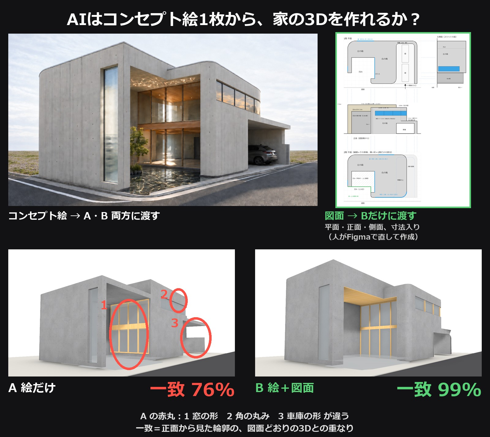
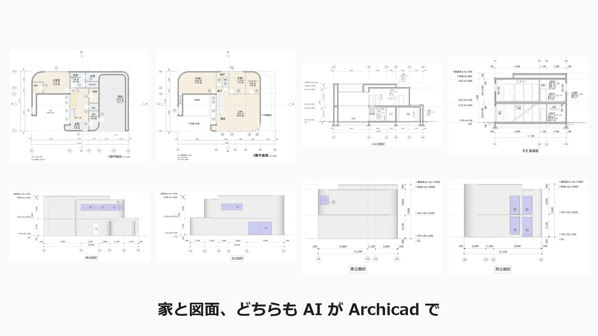
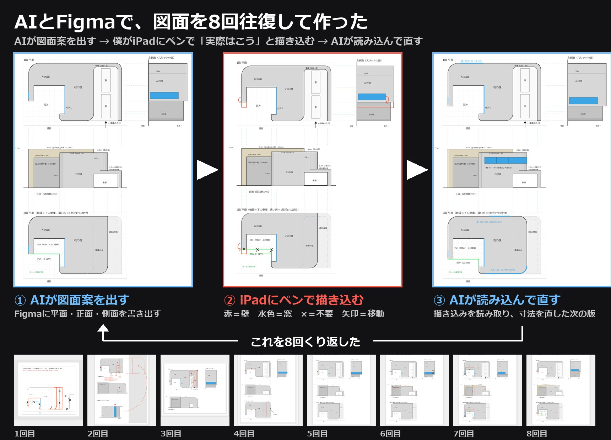

[🇯🇵 日本語](README.md) | 🇺🇸 English

# AI × Architecture Lab

Experiments in which AI does architectural model-making, drawings and materials — published **so that anyone can try the same thing**.

**No programming knowledge needed.** After a one-time setup, you paste one line at a time into an AI (Claude or ChatGPT) — "Read this prompt file and follow its instructions." — and the AI drives Rhino or Archicad to do the work.

Updates: X [@supertask_jp](https://x.com/supertask_jp) (Japanese)

## Getting started

### What you need

- Software: Rhino or Archicad (depends on the experiment)
- An AI, one of these (both paid plans):
  - a paid Claude plan + Claude Code (desktop app)
  - a paid ChatGPT plan + Codex (desktop app)

### Once only: connect the AI to Rhino / Archicad

Copy the "prompt for the AI" from the page below and paste it into the AI. The AI prepares everything needed to drive Rhino / Archicad (about 30–60 min).

- Setup page (with the prompt to paste): https://claude.ai/artifact/UwQrsxsWJztdwNVAd93t8T#en
- Workshop slides (Japanese): https://docs.google.com/presentation/d/11fd7nvZPuE5BPmIBTQYlUanp_OZPNibPhbAnpD_UStg/edit?usp=sharing

### Then: pick an experiment and paste one line per step

1. Pick an experiment from the list below and open its page.
2. As described there, click the green "Code" button on this GitHub page → "Download ZIP" to get the files.
3. In the AI app, open that experiment's folder and paste the line from the table on its page, in a new conversation for each step. For example:
   ```
   Read prompts/00_prepare.md and follow its instructions.
   ```
   In the experiments, too, this one line was all we gave the AI (the experiments used the Hermes Agent AI agent). Check the next line to paste in the table on each experiment's page. Your part is the screen actions the AI asks for, and looking at the results and saying "fix this".

## Experiments

[](experiments/2026-11_image-vs-drawing-3d/README.en.md)

[](experiments/2026-11_archicad-drawing-set/README.en.md)

| Date | Experiment | Summary | Used |
| --- | --- | --- | --- |
| 2026-11 | [Exterior image only vs image + drawings](experiments/2026-11_image-vs-drawing-3d/README.en.md) | The AI built Rhino models of the same house from one exterior image only / image + drawings, and we compared the shape overlap with the correct model (image only 68–80%, with drawings 96–100%) | Claude Opus 5.5, Rhino, Figma, ComfyUI (Qwen-Image 2.1) |
| 2026-11 | [From a blank Archicad project to 8 sheets](experiments/2026-11_archicad-drawing-set/README.en.md) | The AI built a fictional house in a blank Archicad project and, given drawing rules, drew 2 plans, 2 sections and 4 elevations. Sections were weak, so layers and foundations were added to the model and the sheets redrawn; 2–3 rounds of review and fixes | Claude Opus 5.5, Archicad, Tapir |

Figma board where a human and the AI refined the drawings together (view only): [Drawing loop between AI and human (one exterior image → drawings v7–v14)](https://www.figma.com/board/Fajd8nO7JFtNX5Ty2JOus4)

[](https://www.figma.com/board/Fajd8nO7JFtNX5Ty2JOus4)

## Using it in your own work

Each experiment's `rules` and `skills` folders contain the "drawing rules" and "working procedures" given to the AI, as **plain prose** (in Japanese; each folder has an English README explaining the files).
Rewrite them to match how your office works and they become your own procedure documents (skills) for the AI. You can ask the AI to do the rewriting, in your language.

## Notes

- All houses are fictional (made from AI images). No real projects or drawings are used.
- AI answers change every time. You will not get exactly the numbers and drawings shown on each page.
- Some of the step prompts added for publication (preparation, capture, scoring, etc.) have not been run end-to-end. Each page's "Honest notes" says which.

## For advanced users: folder conventions

In each experiment, README.md is the architect-facing description (with the one-line-per-step table), AI_GUIDE.md is the guide for AIs (file list, commands and experiment details are there too). People need only the README; AIs need only AI_GUIDE. English versions have the same name with `.en.md`.

```
experiments/
  YYYY-MM_short-name/
    README.md        … what was tried, results, one line per step, honest notes (for architects)
    AI_GUIDE.md      … guide for AIs (file list, commands, details)
    inputs/          … images and drawings given to the AI
    prompts/         … each step's prompt (read by the AI from the README's one-liners) and the verbatim prompts used in the experiment
    outputs/         … what the AI made (scripts, notes, assumed dimensions)
    scripts/         … preparation, capture, comparison and post-processing scripts
    results/         … comparison images and numbers
docs/                … articles (to be published as a blog via GitHub Pages; Japanese)
```

Read `C:/path/to/kit/` and `<KIT>` in the scripts as locations in your environment (if you follow the step prompts, the AI does this for you).
