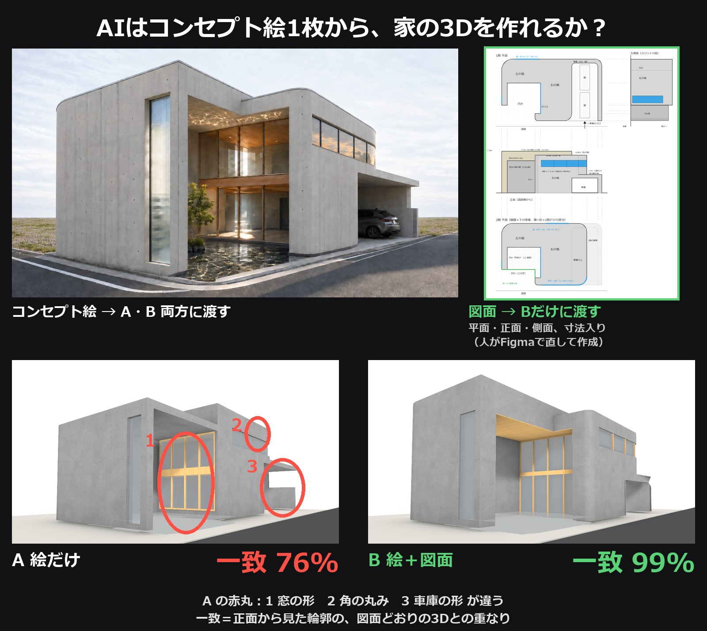
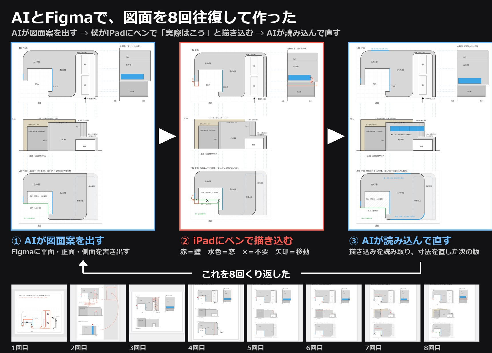

# AI × 建築 実験ラボ

AI（Claude など）に、建築の模型づくり・図面・素材づくりをさせた実験を、**同じことを誰でも再現できる形**で置いています。
各実験フォルダに、AI に渡した指示の原文・入力・出力・手順・使ったソフトの版をまとめています。

発信：X [@supertask_jp](https://x.com/supertask_jp)

## 実験の一覧

[](experiments/2026-11_image-vs-drawing-3d/)

| 日付 | 実験 | 内容 | 使ったもの |
| --- | --- | --- | --- |
| 2026-11 | [外観の絵だけ vs 絵＋図面](experiments/2026-11_image-vs-drawing-3d/) | 同じ家を、外観の絵1枚だけ／絵＋図面で AI に Rhino 模型を作らせ、正解との重なり率を比べた（絵だけ 68〜80%、図面あり 96〜100%） | Claude Opus 5.5, Rhino, Figma, ComfyUI (Qwen-Image 2.1) |

図面を人と AI で往復して整えた Figma ボード（閲覧のみ）：[AIと人の図面往復（外観1枚→図面 v7〜v14）](https://www.figma.com/board/Fajd8nO7JFtNX5Ty2JOus4)

[](https://www.figma.com/board/Fajd8nO7JFtNX5Ty2JOus4)

## フォルダの決まり

```
experiments/
  YYYY-MM_短い名前/
    README.md        … 何を試したか・結果・手順・正直に書いておくこと
    inputs/          … AI に渡した画像・図面
    prompts/         … AI に渡した指示（原文）
    outputs/         … AI が作ったもの（スクリプト・メモ・仮定した寸法）
    scripts/         … 撮影・比較・後処理のスクリプト
    results/         … 比較画像・数値
docs/                … 解説記事（GitHub Pages でブログとして公開する場所）
```

## 注意
- 題材の家はすべて架空（AI 画像から作ったもの）です。実在の物件・図面は使っていません。
- スクリプト内のパス（`C:/path/to/kit/`、`<KIT>`）は、自分の環境に読み替えてください。
