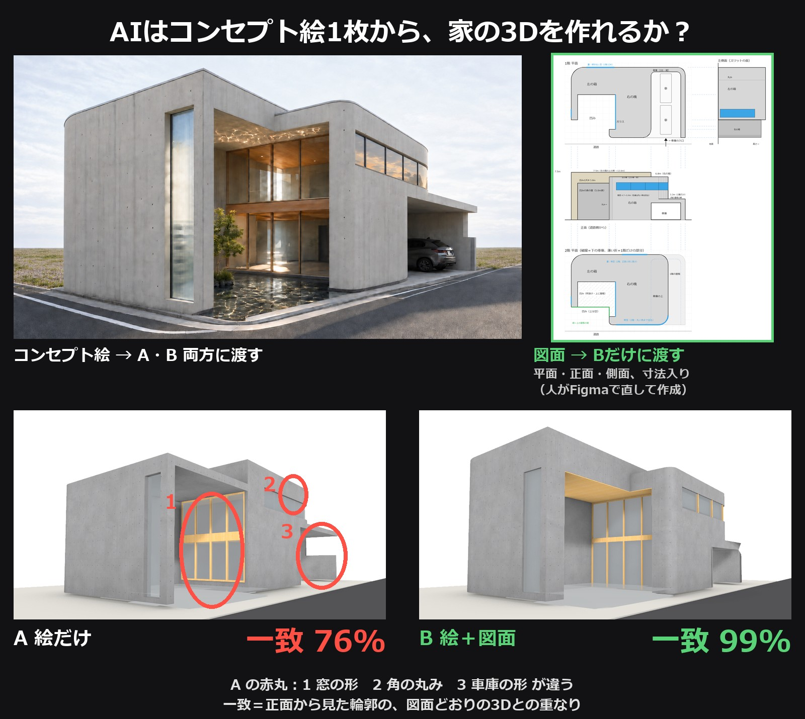
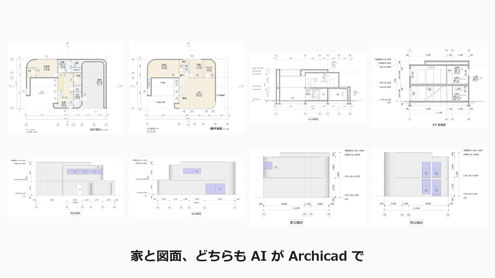
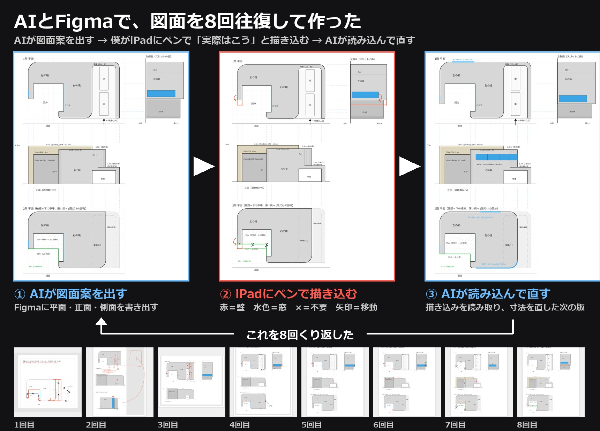

🇯🇵 日本語 | [🇺🇸 English](README.en.md)

# AI × 建築 実験ラボ

AI に、建築の模型づくり・図面・素材づくりをさせた実験を、**誰でも同じことを試せる形**で置いています。

**プログラムの知識は要りません。** 最初に1回だけ準備をすれば、あとは AI（Claude や ChatGPT）に「この指示ファイルを読んで、指示どおりに作業してください」という1行を順に貼るだけで、AI が Rhino や Archicad を動かして作業します。

発信：X [@supertask_jp](https://x.com/supertask_jp)

## はじめに

### 用意するもの

- 使うソフト：Rhino か Archicad（実験によって違います）
- AI：次のどちらか（どちらも有料プラン）
  - Claude の有料プラン ＋ Claude Code（デスクトップ版のアプリ）
  - ChatGPT の有料プラン ＋ Codex（デスクトップ版のアプリ）

### 最初の1回だけ：AI と Rhino・Archicad をつなぐ

下の資料にある「AI への頼み文（プロンプト）」をコピーして、AI に貼ってください。AI が、Rhino・Archicad を AI から動かすための準備を自分で進めます（30〜60分ほど）。

- セットアップ資料（AI に貼る頼み文付き）：https://claude.ai/artifact/UwQrsxsWJztdwNVAd93t8T#ja
- 講座のスライド：https://docs.google.com/presentation/d/11fd7nvZPuE5BPmIBTQYlUanp_OZPNibPhbAnpD_UStg/edit?usp=sharing

### そのあと：実験を選んで、1行ずつ頼む

1. 下の一覧から実験を選び、そのページを開きます。
2. ページの説明どおりに、このページ（GitHub）の緑の「Code」ボタン →「Download ZIP」でファイルを手元に置きます。
3. AI のアプリで、その実験のフォルダを開き、ページの表にある1行を、段ごとに新しい会話に貼ります。たとえば：
   ```
   prompts/00_prepare.md を読んで、指示どおりに作業してください
   ```
   実験でも、AI への頼み方はこの1行だけでした（実験では AI エージェントに Hermes Agent を使いました）。次に貼る1行は、各実験のページの表で確かめます。人がやるのは、AI に頼まれた画面の操作と、できた物を見て「ここを直して」と言うことです。

## 実験の一覧

[](experiments/2026-11_image-vs-drawing-3d/)

[](experiments/2026-11_archicad-drawing-set/)

| 日付 | 実験 | 内容 | 使ったもの |
| --- | --- | --- | --- |
| 2026-11 | [外観の絵だけ vs 絵＋図面](experiments/2026-11_image-vs-drawing-3d/) | 同じ家を、外観の絵1枚だけ／絵＋図面で AI に Rhino 模型を作らせ、正解との形の重なりを比べた（絵だけ 68〜80%、図面あり 96〜100%） | Claude Opus 5.5, Rhino, Figma, ComfyUI (Qwen-Image 2.1) |
| 2026-11 | [白紙の Archicad から図面8枚まで](experiments/2026-11_archicad-drawing-set/) | 架空の家を AI が白紙の Archicad に組み、描き方の決まり（作図ルール）を渡して平面2・断面2・立面4を描かせた。断面が弱かったのでモデルに層と基礎を足して描き直し、点検と直しを2〜3回 | Claude Opus 5.5, Archicad, Tapir |

図面を人と AI でやりとりして整えた Figma ボード（閲覧のみ）：[AIと人の図面往復（外観1枚→図面 v7〜v14）](https://www.figma.com/board/Fajd8nO7JFtNX5Ty2JOus4)

[](https://www.figma.com/board/Fajd8nO7JFtNX5Ty2JOus4)

## 自分の仕事に使うには

各実験の `rules`・`skills` フォルダには、AI に渡した「描き方の決まり」や「作業の手順」が、**ふつうの日本語の文章**で入っています。
自分の事務所のやり方に書き換えれば、それがそのまま自分の AI 用の手順書（スキル）になります。書き換えも AI に頼めます。

## 注意

- 題材の家はすべて架空（AI 画像から作ったもの）です。実在の物件・図面は使っていません。
- AI の答えは毎回変わります。各実験のページの数値や図と、まったく同じにはなりません。
- 各実験で公開用に足した段の指示（準備・撮影・採点など）は、通しでは流して確かめていない物があります。各ページの「正直に書いておくこと」に書いています。

## 詳しい人向け：フォルダの決まり

各実験の README.md は建築家向けの説明（段ごとの1行の表）、AI_GUIDE.md は AI 向けの索引、TECHNICAL.md はファイルの一覧や細部です。英語版は同じ名前に `.en.md` を付けたファイルです。

```
experiments/
  YYYY-MM_短い名前/
    README.md        … 何を試したか・結果・段ごとの1行・正直に書いておくこと（建築家向け）
    AI_GUIDE.md      … AI 向けの索引
    TECHNICAL.md     … ファイルの一覧・コマンド・細部
    inputs/          … AI に渡した画像・図面
    prompts/         … 各段の指示（README の1行で AI が読む）と、実験で AI に渡した指示（原文）
    outputs/         … AI が作ったもの（スクリプト・メモ・仮定した寸法）
    scripts/         … 準備・撮影・比較・後処理のスクリプト
    results/         … 比較画像・数値
docs/                … 解説記事（GitHub Pages でブログとして公開する場所）
```

スクリプトの中の `C:/path/to/kit/`・`<KIT>` は、自分の環境の場所に読み替えます（各段の指示に従えば、AI が読み替えます）。
