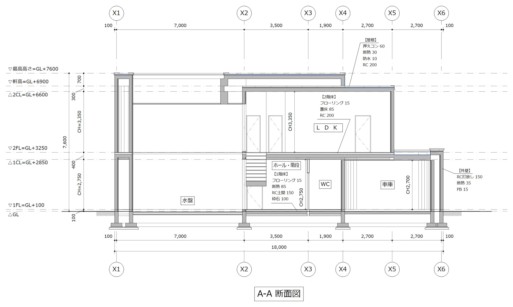
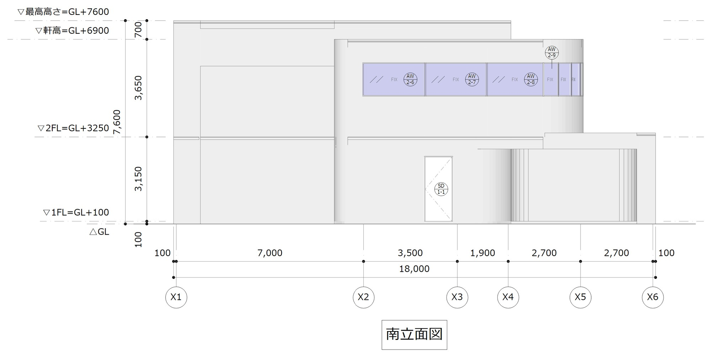

# AIに「実務の図面の描き方」をスキルとして渡したら、白紙の Archicad から図面8枚が出てきた

2026年11月15〜16日に試した記録です。使ったAIは Claude Opus 5.5（AIエージェント Hermes Agent 経由）、ソフトは Archicad と、Archicad に命令を送るアドオン Tapir です。

## 結論

- AI に Archicad を操作させると、白紙のファイルから家のモデルを約14分で組める。図面も描ける
- ただ、何も教えないと「AI なりの図面」になる。実務の図面に寄せるには、**描き方の決まりを書いたファイル（スキル）**を渡すのが効いた
- スキルは一度書いて終わりではない。描かせて、点検して、見つかった失敗をスキルに足す。この**育て方**が、今回いちばん持ち帰れることだった

AI のミスは、数か月もすれば減っていきます。でも「自分たちの描き方を言葉にして AI に渡し、点検しながら育てる」やり方は、AI が賢くなるほど効いてくるはずです。

（動画は X の投稿をご覧ください）

## スキルなしだと「AI なりの図面」になる

同じ立面図を、スキルなし／ありで描かせて並べました（11月14日、少し前の版の家）。

スキルなしでも、それらしい図は描けます。ただ、立面図には出ない壁の厚さを書き込んだり、高さの書き方が実務と違ったりします。スキルありだと、高さは「▽2FL=GL+3250」の形にそろい、通り芯の丸が付き、寸法は通り芯を基準に並びます。

違いは、設計をしている人なら一目で分かる種類のものです。逆に言えば、そこが「実務で使えるか」の分かれ目です。

## スキルとは、描き方の決まりを書いたテキスト

ここで言うスキルは、ただの文章のファイルです。立面・平面・断面の3本を作りました。

**作り方**

1. 実務の図面を、種類ごとに数件ずつ並べる
2. 共通している描き方だけを抜き出す（形や間取りは写さない）
3. 「必ず描くもの」「どちらでもよいもの」「描いた後の点検」に分けて書く

実は、この見比べと書き出しも AI（Hermes）にやらせています。人がやったのは「この描き方に合わせて」と頼むことと、出てきたルールが妙ではないかを見ることでした。

**中身の例（抜粋）**

- 高さは「▽名前=GL+数字」で書く。▽は線の上、△は線の下
- 高さの寸法は2列。外側に全体、内側に階ごと。足すと全体と一致すること
- 通り芯の丸は、図のどちら側に付けるかを決めておく
- 断面図は、壁・床・屋根の層、防水の線、地面の斜線、基礎の下の砕石まで描く
- 文字は線や通り芯に重ねない。重なりは座標で確かめる

描かせる時は「使ってよいのは、このルールと Archicad の中の情報だけ」と指示しました。過去の会話や記憶は使わせていません。ルールだけで、どこまで寄せられるかを見るためです。

## スキルを育てる

ルールを渡しても、1回で完璧にはなりません。今回は8枚を描かせたあと、実務の図面と並べて点検し、直しを指示しました（点検も指示も Hermes）。

- 断面・立面：3回
- 平面：2回

ここで効いたのは、**見つかった失敗を、その場でスキルに足す**ことでした。作図ルールの最後に「前回の失敗（同じことをしない）」という節を作り、次のように書き足していきました。

- 防水の線は、笠木の上や、向こうに見えている箱の上には引かない
- 向こうに見えている壁を、切った面のように塗らない
- 小さい寸法は、高さの線と重ならない所に引き出して書く

人に仕事を教えるのと同じで、ルールは使いながら育ちます。違うのは、書いたことを次から確実に読んでくれることです。

### スキルに書くべきなのは「見えない所」

いちばん大きな学びは、断面図で起きました。最初の断面図は、屋根が厚さ約1mの塊で、基礎もない「張りぼて」でした。

原因は描き方ではなく、モデルでした。AI に「この家と同じ形に組んで」と頼むと、外から見える形は正確に作ります。でも、壁の中の層や地面の下の基礎は、頼まなければ作りません。Archicad の断面図はモデルを切った形なので、モデルが張りぼてなら図も張りぼてになります。

そこで、モデルの壁・床・屋根を層のある部材にし、基礎を足してから描き直しました。断面のルールの冒頭にも、前提として「壁・床・屋根は層のある部材」「切った面の上から塗って隠さない」と書きました。

外から見えない所は、言わなければ作られない。これは今の AI の弱点というより、**仕事を頼む時の決まりごと**だと思います。

### 試して微妙だった頼み方

実務の図面では、小さい部屋にも面積を書きます。そこで「面積の無い部屋に足して」と頼みました。

ところが狭い部屋には文字が入らず、AI は引出線で車庫や建物の外に面積を書きました。これでは車庫の面積に見えます。結局全部消して、小さい部屋は室名だけにしました。

「実務の図面ではこうなっている」をそのまま頼むと、図の大きさによっては破綻します。スキルには、決まりだけでなく「どこまでやるか」も書いておく必要があります。

## 点検も、決まりにしておく

点検のやり方も、スキルに入れています。

- **数値**：高さの値がモデルと合っているか、寸法を足すと全長になるか、通り芯がほかの図と同じか
- **位置**：線が文字に入っていないか、のような判定は、画素や座標で確かめる

画像を AI に見せて「重なってない？」と聞くだけだと、実際と違う答えが返ることがありました。点検を数字にしておくと、AI に任せても結果がぶれにくくなります。

## 今の時点で残っていること

- 車庫の壁が二重に見える、断面に小さなすき間がある、など細部はモデル側の問題として残っている
- 寸法は線と文字で描いた「絵」で、モデルを変えても動かない
- 8枚を続けて描かせている間に、Archicad が2回落ちた（1枚ごとに保存して続けた）

このあたりは、AI やソフトが変われば数か月で変わるはずです。

## スキルと手順は GitHub に置きました

作図ルール3本、AI に渡した指示の原文、モデルを直したスクリプト、仕上がりの図を置いています。作図ルールは、そのまま自分の AI に渡して使えます。自分の事務所の描き方に書き換えれば、それがそのままスキルになります。

https://github.com/supertask/ai-architecture-lab/tree/master/experiments/2026-11_archicad-drawing-set

1. Archicad に Tapir を入れ、空のプロジェクトを作る
2. AI に「指示ファイルを読んで、その指示どおりに作業して」と入力する（家を組む → 間取り → 図面1枚ずつ）
3. 描いた図を点検し、失敗をルールに足して、直しを頼む

## 次回：寸法を1つ変えたら、図面8枚は追従するか

今回の寸法は、線と文字で描いた「絵」です。次は、モデルの寸法を1か所変えた時に、平面・立面・断面がそろって追従するかを試します。

（2026年11月時点、Claude Opus 5.5 での結果です）
