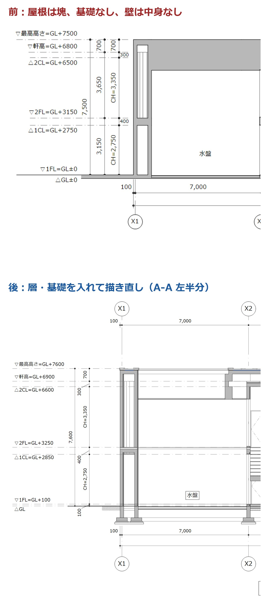

> タイトル案：白紙の Archicad から、AI が家を組んで図面8枚まで仕上げた
> （note 用の元原稿。動画は X の投稿を埋め込む）

# 白紙の Archicad から、AI が家を組んで図面8枚まで仕上げた

2026年11月15〜16日に試した記録です。使った AI は Claude Opus 5.5（AI エージェント Hermes Agent）、ソフトは Archicad と、Archicad に命令を送るアドオン Tapir です。AI の性能はすぐ変わるので、この時点での結果として読んでください。

## 何をしたか

架空の家「打放しと水盤の家」を題材にしました。RC の2階建てで、大きさは 18,000 × 11,100 です。

やったことは2つです。

1. 何もない Archicad のファイルに、AI が家を組む
2. その家から、AI が図面を描く（平面2枚・断面2枚・立面4枚の計8枚）

AI は Tapir を通して、壁・床・窓を置き、線・文字・寸法・塗りを足しています。

## 流れ

### 1. 家を組む（録画あり・約14分）

指示は1つです。「Rhino で作った家のスクリプトと画像を読んで、Archicad の壁・スラブ・窓・扉で組んで」。見ている人に分かるよう、部材は1つずつ置かせました。

（ここに X の動画を埋め込む）

このあと別の指示で、間仕切り・内部の扉・階段・部屋を入れ、通り芯を1組決めさせました。以後の図面は全部この通り芯を使います。

### 2. 南立面図を仕上げる（録画あり・約10分）

「実務の作図ルール」を書いたファイルを渡して、南立面図を仕上げさせました。ルールには、レベルの書き方（▽2FL=GL+3250 など）、高さ寸法を2列にする、通り芯の丸は下側、寸法の端は黒丸、といった描き方の決まりを書いています。

AI が使ってよいのは、このルールと Archicad から読める情報だけにしました。過去の会話や記憶は使わせていません。

※動画の南立面図は、後で説明するモデルの直しより前の版です。

### 3. 残りの図面（録画なし）

平面2枚・断面2枚・ほかの立面3枚も、同じやり方で描かせました。こちらは録画も時間計測もしていません。

## AI が外した所と、直し方

### 最初の断面図は「形だけ」だった

一番弱かったのは断面図です。

- 屋根が厚さ約1mの塊
- 基礎がない
- 壁の中身（層）がない

これは描き方の問題ではなく、モデルの問題でした。Archicad の断面図はモデルを切った形がそのまま出るので、モデルが塊なら図も塊になります。図の上から線を描き足して取り繕うことはしませんでした。

### モデルを直してから描き直した

Hermes がスクリプトでモデルを直しました。

- 外壁：RC150＋断熱35＋PB
- 間仕切り：PB12.5＋LGS95＋PB12.5
- 屋根：塊をやめて、押えコン60＋断熱30＋防水10＋RC200 の板と、天井、パラペットの壁に分けた
- 床：2階はフローリング15＋置床85＋RC200、1階はフローリング15＋断熱85＋RC土間150＋砕石100
- 基礎：外壁の下に足した（底は GL-850）
- 高さ：全部の階を100上げて、1FL＝GL+100 に

そのうえで断面図のルールを新しく書き、8枚を1枚ずつ描き直させました。断熱や防水の線が、モデルから図に出るようになりました。

### 直しは1回では終わらなかった

描き直した図も、そのままでは足りませんでした。実務の図面の描き方（作法）と比べて点検し、Hermes が直しの指示を書いて AI に渡しています。

- 断面・立面：3回
- 平面：2回（1階は途中で時間切れになり、やり直しを1回）

多かった直しは、文字と線の重なり、防水の線の位置、小さい寸法の置き場所でした。

Hermes が Archicad の画面で直接やったこともあります。断面の印の名前を A / B に変えた、書き出しのときに地中（基礎）の画層を隠した、AI が足した小さい部屋の面積表示（かえって分かりにくくなった物）を外した、の3つです。直しの指示には「直したら座標を読み直して、重なりが無くなったことを数値で確かめる」と書いています。

## 点検の仕方

点検は、見た目と数値の両方でやりました。

- 数値：レベルの値がモデルと合っているか、寸法を足すと全長になるか、通り芯がほかの図と同じか
- 見た目：図を画像に書き出し、部分を拡大して読む
- 位置：線が文字に入っていないか、のような細かい判定は、画像を1行ずつ読んで画素で確かめる

画像を AI に見せて聞くだけだと、「線が短い」「数字が重なる」と実際と違う答えが返ることがありました。位置の判定を画素や座標でやったのはそのためです。

## 残った弱点

今の8枚にも、直しきれていない所があります。

- 車庫の壁が二重に見える（モデルに 0.3m 離れた壁が2枚ある）
- 1階平面に、スラブの角の円弧が見えている所がある
- A-A 断面で、梁の所に小さい白いすき間がある
- X6 の基礎にすき間がある

どれもモデル側の問題で、図面の上では直していません。

ほかにも正直に書いておくと、

- 寸法は線と文字で描いていて、モデルを変えても追従しません
- 8枚を続けて描かせている間に、Archicad が2回落ちました。1枚ごとに保存する形にして続けました
- 試したのは1回ずつです。AI や回数を変えると結果は変わります

## 再現するには（GitHub）

AI に渡した指示の原文、作図ルール、モデルを直したスクリプト、仕上がりの図を GitHub に置きました。

https://github.com/supertask/ai-architecture-lab/tree/master/experiments/2026-11_archicad-drawing-set

手順は README に書いています。大まかには、

1. Archicad に Tapir を入れ、空のプロジェクトを作る
2. AI に「指示ファイルを読んで、その指示どおりに作業して」とだけ入力する（家を組む → 間取り → 図面1枚ずつ）
3. 断面に層と基礎を出すため、スクリプトでモデルを直す
4. 図を点検して、直しの指示を入れる

## 次回：寸法の連動

今回の寸法は、線と文字で描いた「絵」です。モデルの壁を動かしても、寸法は動きません。

次は、モデルの寸法を1か所変えたときに、平面・立面・断面の寸法がそろって追従するかを試す予定です。

（2026年11月時点、Claude Opus 5.5 での結果です）
