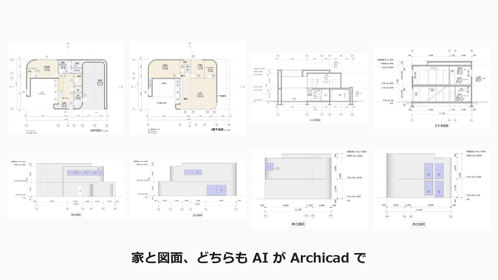
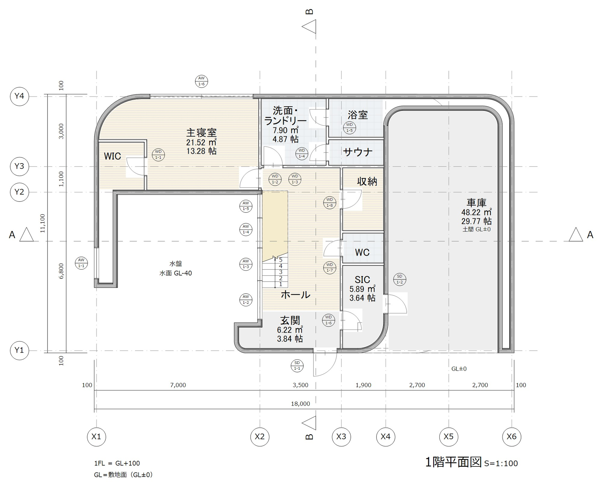

# AIに白紙の Archicad から家と図面8枚を作らせた。家は14分で建った。でも断面図は「張りぼて」だった

2026年11月15〜16日に試した記録です。使ったAIは Claude Opus 5.5（AIエージェント Hermes Agent 経由）、ソフトは Archicad と、Archicad に命令を送るアドオン Tapir です。AIの性能は短い期間で大きく変わるので、この時点の結果として読んでください。

## 結論

- **家のモデル**：指示1つで、白紙の Archicad に AI が壁・床・屋根・窓・階段を置いて、約14分で組み上がった
- **図面**：平面2・立面4・断面2の8枚を、AI が描いた。南立面図1枚なら約10分
- **ただし**：実務の図面の作法に合わせるには、点検と直しが3回要った。最初の断面図は、外から見た形だけの「張りぼて」だった

AI に Archicad を操作させれば、図面の**たたき台**はもう作れます。でも、そのまま人に出せる図ではありません。一番の発見は、図面の弱さの原因が「描き方」ではなく「モデル」にあったことでした。

（動画は X の投稿をご覧ください）

## なぜ試したか

前回は「コンセプト絵1枚から、AI は家の3Dを起こせるか」を試しました（絵だけだと一致率 68〜80%、図面ありなら 96〜100%）。

今回はその続きです。できた家を Archicad（設計事務所で使われている BIM ソフト）に入れて、**AI に実務の図面まで描かせたらどうなるか**を見ました。

## やったこと

1. **家を組む**（録画あり・約14分）：「Rhino の家のスクリプトと画像を読んで、Archicad の壁・床・窓・扉で組んで」と指示1つ。見ている人に分かるよう、部材は1つずつ置かせました。
2. **南立面図を仕上げる**（録画あり・約10分）：「実務の作図ルール」を書いたファイルを渡しました。高さの書き方（▽2FL=GL+3250）、高さ寸法は2列、通り芯の丸は下側、といった描き方の決まりです。AI が使ってよいのはこのルールと Archicad の中の情報だけで、過去の会話や記憶は使わせていません。
3. **残りの7枚**（録画なし）：平面2枚・断面2枚・ほかの立面3枚も同じやり方で描かせました。

※動画の南立面図は、このあと説明するモデルの直しより前の版です。

## 一番の発見：断面図は「張りぼて」だった

立面図と平面図は、作法の細かい違いはあっても、それらしく描けました。崩れたのは断面図です。

- 屋根が厚さ約1mの塊
- 基礎がない
- 壁の中身（コンクリート・断熱・ボードの層）がない

### なぜ張りぼてになったのか

**1. AI は「外から見える形」を作る**
最初の指示は「Rhino の家と同じ形に組んで」でした。AI は外から見た形を正確に再現しましたが、壁の中身や屋根の層、地面の下の基礎は作りませんでした。外から見えない所は、頼まなければ作られません。前回の「絵に写っていない所は想像で埋める」と同じで、見えない所が弱点です。

**2. Archicad の断面図は、モデルを切った形がそのまま出る**
断面図は、モデルを包丁で切った断面です。モデルが塊なら、図も塊になります。描き方をいくら工夫しても直りません。

**3. AI は図の上から塗って隠そうとした**
最初の版で、AI は切断面の上にグレーの塗りを重ねて、塊を「それっぽく」見せていました。これではモデルを直しても層が隠れてしまうので、この塗りは全部消して描き直させました。

### 直し方：図ではなくモデルを直す

そこで図の上で取り繕うのはやめて、モデルを直しました（Hermes がスクリプトで実行）。

- 外壁を「コンクリート＋断熱＋石膏ボード」の層のある壁にした
- 屋根を、塊ではなく「押えコンクリート・断熱・防水・コンクリート」の板と天井に分けた
- 床にも層を入れ、外壁の下に基礎を足した
- 1階の床を地面より 100mm 上げた

そのうえで断面図の作図ルールを新しく書き、8枚を描き直させました。断熱や防水の線が、**図の上に描いたのではなく、モデルから出る**ようになりました。

## AI は1回では直しきれない

描き直した図も、そのままでは足りませんでした。実務の図面の描き方と並べて点検し、直しの指示を書いて AI に渡しました（点検も指示も Hermes）。

- 断面・立面：3回
- 平面：2回
- 直し1回にかかった時間：断面・立面は1枚 5〜15分、平面は約25分

多かったのは、文字と線の重なり、防水の線の位置、小さい寸法の置き場所です。困ったのは次の2つでした。

- **ルールに書いた失敗を、もう一度やる**：「防水の線はここに引く」と書いても、2回目に同じ種類の誤りが残りました。
- **直した所の近くで、新しくずれる**：重なりを直すと、隣の文字にぶつかる。最後は「直したら周り1mを読み直して、新しい重なりがないか数値で確かめる」と指示に書きました。

### 試して微妙だった方法

実務の図面では、小さい部屋にも面積を書きます。そこで「面積の無い部屋に面積を足して」と頼みました。

ところが、狭い部屋には文字が入らず、AI は引出線で車庫や建物の外に面積を書きました。これだと、車庫の面積に見えてしまいます。結局、この面積は全部消して、小さい部屋は室名だけにしました。

「実務の図面はこうなっている」をそのまま頼むと、狭い所で破綻する。頼み方には、図の大きさとの相談が要ります。

## 点検の仕方

- **数値**：高さの値がモデルと合っているか、寸法を足すと全長になるか、通り芯がほかの図と同じか
- **見た目**：図を画像に書き出し、部分ごとに拡大して読む
- **位置**：線が文字に入っていないか、のような細かい判定は、画素や座標で確かめる

画像を AI に見せて聞くだけだと、「線が短い」「数字が重なる」と実際と違う答えが返ることがありました。位置の判定を数値でやったのはそのためです。

## 残った弱点

- 車庫の壁が二重に見える（モデルに 0.3m 離れた壁が2枚ある）
- 1階平面に、上の階の床の角が写り込んでいる
- 断面図で、梁の所に小さな白いすき間、基礎に小さなすき間

どれもモデル側の問題で、図面の上では直していません。ほかに、

- 寸法は線と文字で描いた「絵」で、モデルを変えても動きません
- 8枚を続けて描かせている間に、Archicad が2回落ちました。1枚ごとに保存する形にして続けました
- 試したのは1回ずつです。AI や回数を変えると結果は変わります

## 実務で使えるか（本音）

- **使える**：白紙から家のモデルを起こす、図面一式のたたき台を作る、作法のチェックを数値でやる
- **まだ人が要る**：見えない所（層・基礎・納まり）を決める、AI の直しが新しいずれを生んでいないかを見る

AI は描くのが速い。でも「何が見えていないか」を指摘するのは、まだ人（か、点検役の AI）の仕事です。

## 再現するには（GitHub）

AI に渡した指示の原文、作図ルール、モデルを直したスクリプト、仕上がりの図を置きました。

https://github.com/supertask/ai-architecture-lab/tree/master/experiments/2026-11_archicad-drawing-set

1. Archicad に Tapir を入れ、空のプロジェクトを作る
2. AI に「指示ファイルを読んで、その指示どおりに作業して」とだけ入力する（家を組む → 間取り → 図面1枚ずつ）
3. 断面に層と基礎を出すため、スクリプトでモデルを直す
4. 図を点検して、直しの指示を入れる

## 次回：寸法を1つ変えたら、図面8枚は追従するか

今回の寸法は、線と文字で描いた「絵」です。次は、モデルの寸法を1か所変えたときに、平面・立面・断面がそろって追従するかを試します。

（2026年11月時点、Claude Opus 5.5 での結果です）
