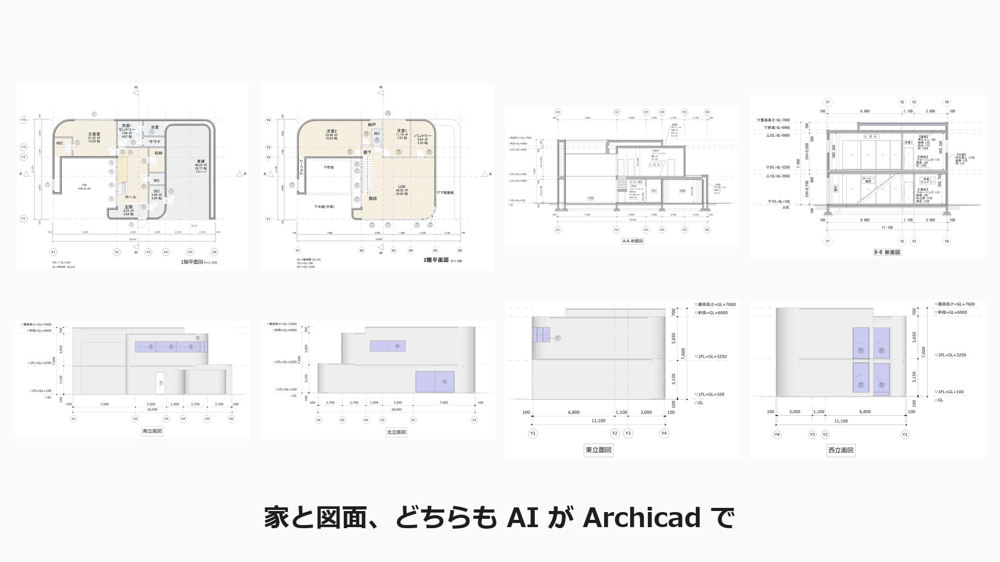
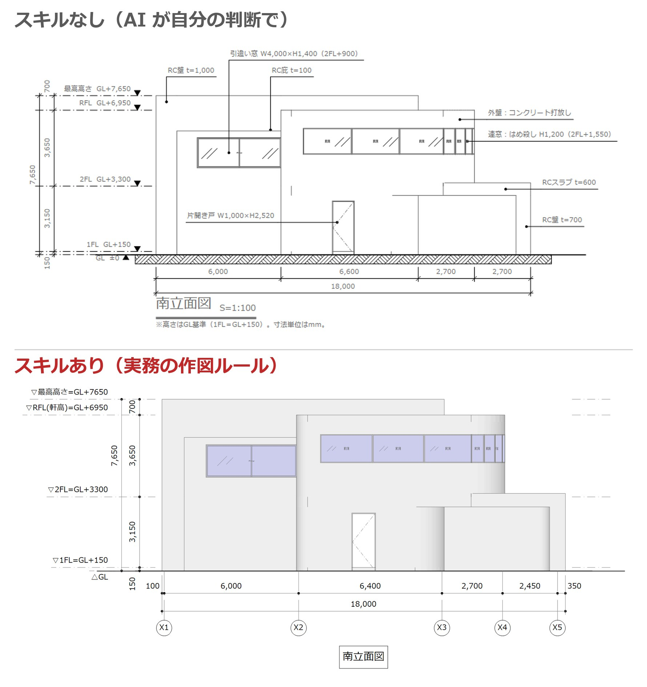
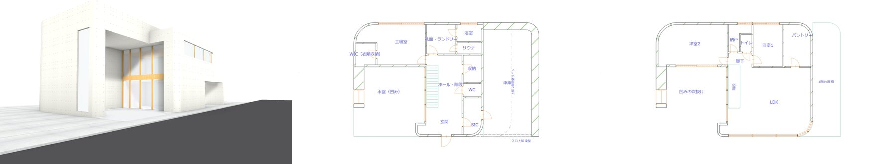
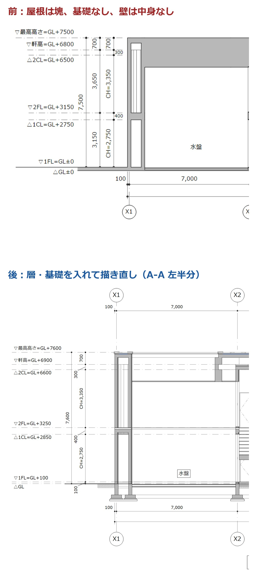
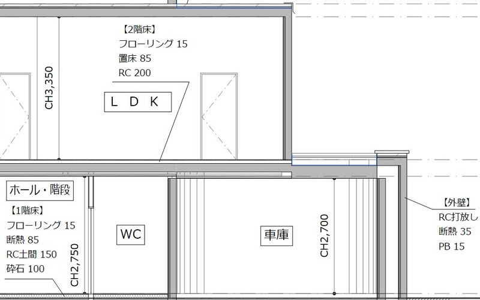

[🇯🇵 日本語](README.md) | 🇺🇸 English

# One line at a time: an AI builds a house in a blank Archicad project and draws 8 sheets

This is the record of an experiment in which an AI built a fictional house — the "Fair-faced Concrete and Water Basin House" (2-storey RC) — in a blank Archicad project and drew 8 sheets: 2 floor plans, 2 sections and 4 elevations.
Everything you need to try it yourself is in this folder.

**You do not need to write any code.** After a one-time setup, you paste the "one line" from the table below into the AI, step by step, and do a few short actions in Archicad yourself.



## What you get

- A house model built from scratch: walls, slabs, roof, windows, doors, partitions, stair, rooms (zones). Walls and slabs get layered build-ups and foundations so the sections read properly.
- 8 sheets: ground- and first-floor plans, sections A-A and B-B, and the north/south/east/west elevations.

**Giving the AI "drawing rules" brings the sheets closer to professional practice.** Top: without rules; bottom: with rules (the same south elevation, of a slightly earlier version of the house).
With the rules, levels are written uniformly as "▽2FL=GL+3250", grid bubbles appear, and dimensions are measured from the grid lines.



## What you need

- **Archicad** (tested with the Japanese version and its standard template — see "What will not be identical")
- **An AI**, one of these (both are paid plans):
  - a paid Claude plan + Claude Code (desktop app)
  - a paid ChatGPT plan + Codex (desktop app)
- **One-time setup (30–60 min)**: copy the "prompt for the AI" from the setup page below and paste it into the AI. The AI installs and connects what is needed to drive Archicad from the AI (the Tapir add-on, etc.).
  - Setup page: https://claude.ai/artifact/UwQrsxsWJztdwNVAd93t8T#en
  - Workshop slides (Japanese): https://docs.google.com/presentation/d/11fd7nvZPuE5BPmIBTQYlUanp_OZPNibPhbAnpD_UStg/edit?usp=sharing
- **You do not need Rhino.** The house data is written as a Rhino script, but the AI only reads the numbers in it.

## Getting started (once)

1. **Get this folder**: on this GitHub page, click the green "Code" button → "Download ZIP". Unzip it and put the folder "experiments" → "2026-11_archicad-drawing-set" somewhere easy to find. (You can also ask the AI: "Download supertask/ai-architecture-lab from GitHub".)
2. **In the AI app, choose the folder from step 1 as the working folder** (apps call it "Open folder", "Add project", etc.). Always start your conversations in this folder.

## How to run it: follow the table, one line at a time

In the experiment, the steps where the AI works were run by **pasting a single line — "Read <file>.md and follow its instructions" — into a fresh AI conversation** (the agent was Hermes Agent; you use Claude Code or Codex).
Start a **new conversation** for each line (so the AI does not reuse values from the previous sheet). The AI does not tell you the next line — follow this table.
The prompt files are in Japanese; the AI reads them fine. You can paste the line in English as shown.

The "In the experiment" column says how that step was done in the experiment:

- **Same prompt, run as-is**: the experiment's prompt file, unchanged (only how paths and the port are written is substituted)
- **Same scripts run (prompt newly added)**: in the experiment, the experimenter's AI ran these scripts directly. We added a short prompt that only runs the same scripts in the same order
- **By hand**: a person does it in the Archicad GUI
- **Added (not used)**: added for the public kit; not used in the experiment

| Step | Line to paste (or what you do) | What happens | In the experiment | When it finishes | Time |
| --- | --- | --- | --- | --- | --- |
| 0 | You: start Archicad and open an empty project (File › New) | — | By hand | go to step 1 | 1 min |
| 1 | `Read prompts/00_prepare.md and follow its instructions.` | Checks the connection, creates the work folder (`work`), sets the stories to 1FL/2FL/RFL and saves as "house_from_scratch" in `work` | Added (not used) *1 | check the output the AI shows has no "NG" or errors | a few min |
| 2 | `Read work/prompts/01_model_M.md and follow its instructions.` | Places exterior walls, slabs, roof, windows and doors one by one | Same prompt, run as-is | save in Archicad (File › Save) | ~14 min |
| 3 | `Read work/prompts/02_interior_I.md and follow its instructions.` | Partitions, doors, stair, rooms; fixes one set of grid lines in `work/grid.json` | Same prompt, run as-is | save; check `grid.json` exists in `work` | ~18 min |
| 4 | `Read work/prompts/05_sections.md and follow its instructions.` | Creates 4 elevation lines and the A-A / B-B section lines | Same scripts run (prompt newly added) *2 | go to step 5 | a few min |
| 5 | You: in the Navigator, Project Map → Sections, double-click each of the 6 (S南 = south, S東 = east, S北 = north, S西 = west, A-A, B-B) once to open it | Some versions cannot open a newly created section window from the AI | By hand | save | a few min |
| 6 | `Read work/prompts/06_fix_model.md and follow its instructions.` | Layered walls/slabs/roof, foundations, whole house raised 100 so 1FL = GL+100, deletes previously drawn 2D (usually none in this order) | Same scripts run (prompt newly added) | save | a few min |
| 7 | 8 lines, one at a time, each in a new conversation: `Read work/prompts/12_sheet_SA.md and follow its instructions.` → `13_sheet_SB` → `14_sheet_ES` → `15_sheet_EN` → `16_sheet_EE` → `17_sheet_EW` → `10_sheet_P1` → `11_sheet_P2` | Reads the drawing rules and draws one sheet at a time (sections A-A, B-B; south, north, east, west elevations; ground- and first-floor plans) | Same prompt, run as-is (in this order) | **save after every sheet**, then the next line | 12–35 min per sheet; ~3 h for 8 |
| 8 | You: in the Navigator, right-click "S-01 A-A" → rename the section, set the Reference ID to A; same for "S-01 B-B" → B | Section markers on the plans read A / B (the AI cannot change this) | By hand *3 | save | a few min |
| 9 | `Read work/prompts/18_export.md and follow its instructions.` | Moves below-ground elements (foundations etc.) to their own layer and exports the 8 sheets as images | Same scripts run (prompt newly added) | look at the 8 images in this folder's `out` → `png` | 5–10 min |
| 10 | `Read work/prompts/30_inspect_and_fix.md and follow its instructions.` (add what you noticed after it) | Reviews the sheets, writes fix prompts and fixes them (one round) | Added (not used) | stop after 2–3 rounds | ~1–1.5 h per round |

- *1 In the experiment, the blank project was the previous model of this house saved under a new name and emptied; its stories (1FL/2FL/RFL) were kept as they were. Step 1 sends the same story settings that were sent in that earlier round. The connection check and work-folder creation were added for the public kit.
- *2 In the experiment, these lines were created on the previous model with the same procedure (the script this one was generalized from) and were still in the emptied project.
- *3 In the experiment, this was done midway through the review/fix rounds (between the 3rd and 4th fix).
- Step 7 can also be run as a batch (`scripts/run_sheets.sh`: hands each prompt to a fresh AI run and saves after each sheet; see [TECHNICAL.en.md](TECHNICAL.en.md)). This is the same shape as the experiment's batch run.
- In step 10, add what you noticed in plain words after the line. Example: `Read work/prompts/30_inspect_and_fix.md and follow its instructions. In section A-A, the blue waterproofing line runs up over the parapet coping.`
- **The flow in this table has not yet been run end-to-end from the public kit** (see "Honest notes").

### Prompts included as records of the experiment (not part of the normal order)

| File | Content | In the experiment |
| --- | --- | --- |
| `03_south_elevation_recorded.md` | The recorded south-elevation round (house before the model fix) | Same prompt, run as-is |
| `04_fix_partition_F.md` | Fixed a partition that pierced the roof and cleared some sheets' 2D for redrawing | Same prompt, run as-is |
| `20_`–`22_` (section A-A fixes, rounds 2–4), `23_`–`25_` (ground-floor plan fixes) | Records of the experiment's fixes (written for the mistakes of that run; they often will not apply to your result) | Same prompt, run as-is |

## What happens in each step

### ① Build the house (steps 0–3)

The house data the AI reads is in the `inputs` folder: left, the exterior (a house built in Rhino); middle and right, the ground- and first-floor layout drawings (all fictional).



- **What the AI does**: in step 2 it reads the numbers in the house data and places, one at a time: ground-floor walls → first-floor walls → slabs/roof/ground → windows/doors. In step 3 it looks at the layout drawings, adds partitions, doors, the stair and rooms, then fixes one set of grid lines and writes them to a file.
- **What you see**: in Archicad's 3D window the house goes up piece by piece. The AI prints one line per stage, e.g. "Creating the ground-floor walls".
- **How to tell it finished correctly**
  - [ ] In 3D you see exterior walls, the first-floor slab, roof, windows, entrance door, carport and ground (step 2)
  - [ ] The floor plan shows partitions, doors, the stair and room names (step 3)
  - [ ] The AI wrote "完了" (done)

### ② Draw the sheets (steps 4–9)



- **What the AI does**: step 4 draws four elevation lines outside the building plus section lines A-A and B-B. Step 6 turns walls, slabs and roof into layered (composite) elements, adds foundations, and raises the whole house by 100 so that 1FL = GL+100 (figure above — in the experiment the roof was first a ~1 m thick solid block with no foundations, a "stage prop"). Step 7 reads the drawing rules for each sheet type and draws grid lines, dimensions, levels, room labels, fills and so on. Step 9 exports the 8 sheets as images.
- **What you see**: Archicad switches between section/elevation windows and plans; lines and texts are added type by type. Below is part of the finished section A-A.



- **How to tell it finished correctly**
  - [ ] After step 6, the A-A section window shows layer lines in roof, slabs and walls, and foundations are visible
  - [ ] For each of the 8 sheets the AI wrote "完了"
  - [ ] The folder `out` → `png` contains the 8 images `hi_P1.png` … `hi_EW.png`; levels read like "▽2FL=GL+3250"; grid bubbles with names are present

### ③ Review and fix (step 10)

- **What the AI does**: checks the 8 sheets by image and by numbers (do the level numbers match the model, do the dimension strings add up to the overall length, do texts overlap). It compares them with the drawing rules, writes fix instructions per sheet and fixes them one at a time.
- **What you do**: add, in plain words, what you want fixed. Read the report and decide whether to do another round.
- In the experiment, the experimenter's AI did this review, wrote prompts like 20–25 and ran them one by one. The step-10 prompt puts that work into words for the public kit and was not used in the experiment.

## Troubleshooting

| Situation | What to do |
| --- | --- |
| "Archicad not found", "port" or "NG" appears | Make sure Archicad is running with a project open, then paste the same line again. If it still fails, the one-time setup (setup page) is not done yet. |
| The AI stopped with an error | Show the output to the AI and ask what happened. Before re-running the same line, check how far it got (some scripts in steps 6 and 9 raise/lower things again if run twice). |
| Archicad crashed | Restart Archicad and open "house_from_scratch" in the `work` folder (answer "No" if asked to restore). Continue from the last save with the next line in the table, in a new conversation. |
| Texts or lines overlap on a sheet | Add the location and what you see after the step-10 line. Example: "On the ground-floor plan, the carport area text overlaps grid line X5." |

## Time and cost

| Request | AI working time (from the experiment logs) |
| --- | --- |
| ① Build the house | Massing ~14 min + layout ~18 min |
| ② Draw the sheets | Lines and the layer/foundation fix: a few minutes of scripts + 8 sheets ~3 h (sections 30–35 min each, elevations 14–19 min, plans 12–26 min) |
| ③ Review and fix | ~1–1.5 h per round (5–30 min per sheet); 2–3 rounds in the experiment |

Most of the time is the AI thinking; you just wait. The AI runs within your Claude or ChatGPT plan. The work is long, so depending on your plan you may hit the usage limit midway; if so, wait and paste the same line again.

## What will not be identical

- **AI answers differ every time.** Positions of lines and texts, and layout details, change from run to run. You will not get the same sheets as shown here.
- **The professional drawings used as references are not published.** Only the text of the "drawing rules" distilled from them is included.
- **A different Archicad language or template may stop the run.** Material names (e.g. "コンクリート", concrete) are those of the Japanese standard template.

## Use it in your own office

The drawing rules given to the AI are **plain Japanese prose** in the `rules` folder — not code ([rules/README.en.md](rules/README.en.md) explains each file in English). For example, the section rule says (translated):

> **Levels**
> - Format: ▽Name=GL+number (no comma, no unit). GL is written △GL.
> - For ▽ (tops: max height, eaves, each FL) the text sits above the line; for △ (ceiling CL and GL) below the line.
>
> **Ground**: GL as a thin solid line extending well beyond both sides of the building. Outside the building, a ~1 m wide band of earth hatching below GL (not under the building).

**Rewrite these to match how your office draws, and they become your office's skill (a procedure document for the AI).** You can ask the AI to do the rewriting:

```
Rewrite the section rules in the rules folder to match how this office draws sections, in English. Use the PDF I put in this folder as the reference. Do not copy shapes or layouts — describe only how things are drawn.
```

**Growing the rules**: have the AI draw, review, and append each mistake to the "previous mistakes" section at the end of the rule. In the experiment, for example, these were added (translated):

> - Drew the blue waterproofing line on top of the parapet coping and on the top of boxes seen beyond. → The blue line goes only on the RC top of the cut roof slab and up the inner face of the parapet; stop below the coping.
> - Small dimensions (300, 400, 100) overlapped the dash-dot level lines. → Pull them out and write them in a free space.

Rules are followed better when the AI gets only the rules for the sheet type it is drawing, rather than all of them at once (each step's prompt does this).

## Honest notes

- **Not run end-to-end**: the prompts of steps 2, 3 and 7 (01, 02, 10–17) and the records 03, 04, 20–25 are exactly what was given, as one line "Read ….md and follow its instructions", to a fresh conversation of an AI (Hermes Agent + Claude Opus 5.5) in the experiment. The short prompts of steps 1, 4, 6 and 9 only run the scripts the experimenter's AI ran directly, in the same order, but the prompt text itself is new; step 10 was not used in the experiment. The flow in the table has not been run start to finish from the public kit, and has not been tried with Claude Code or Codex. Please tell us where you get stuck.
- Only two parts were screen-recorded and timed: building the massing (~14 min) and one south elevation (~10 min). The other times are estimates from start/end timestamps. The recorded south elevation predates the layer/foundation fix and differs from the south elevation among the 8 sheets above.
- Before the 8 sheets reached their current state, sections and elevations were fixed 3 times and plans twice. They were not right first time.
- The review and fix instructions were written by the AI agent used in the experiment (Hermes Agent — a tool that lets an AI work on a computer). The same AI also did the model fix (layers and foundations) with scripts.
  Besides the lines drawn by the AI, Hermes changed three things directly: renamed the section markers to A/B; hid the below-ground (foundation) layer when exporting elevations and plans; removed area labels the AI had added to small rooms (which made them harder to read).
- Remaining weak points: the carport wall looks doubled / slab-corner arcs are visible on the ground-floor plan / a small white gap at the beam in section A-A / a gap in the foundation at grid X6.
- Dimensions are drawn as lines and text; they do not follow model changes (the next experiment deals with this).
- Archicad crashed twice while drawing the 8 sheets in a row. That is why the project is saved after every sheet.
- The drawing rules summarize only drafting conventions of professional drawings; no shapes, plans or numbers were copied. The house is fictional. Each was a single trial; results change with other AIs or more runs.
- Used: AI Claude Opus 5.5 (via Hermes Agent); software Archicad and Tapir. 15–16 November 2026.

## For advanced users and AIs

- [AI_GUIDE.en.md](AI_GUIDE.en.md): index for AI agents
- [prompts/](prompts/): the prompt for each step (the files the AI reads from the one-liners above; in Japanese)
- [TECHNICAL.en.md](TECHNICAL.en.md): file list, the order actually followed, how the model was fixed, where the scripts (small programs written by the AI) came from
- [skills/](skills/README.en.md): tips for driving Archicad and how to review drawings (for AIs)
- [rules/](rules/README.en.md): drawing rules (plans, sections, elevations)
- Draft of the explanatory article (Japanese): [docs/2026-11-16-archicad-drawing-set.md](../../docs/2026-11-16-archicad-drawing-set.md)
