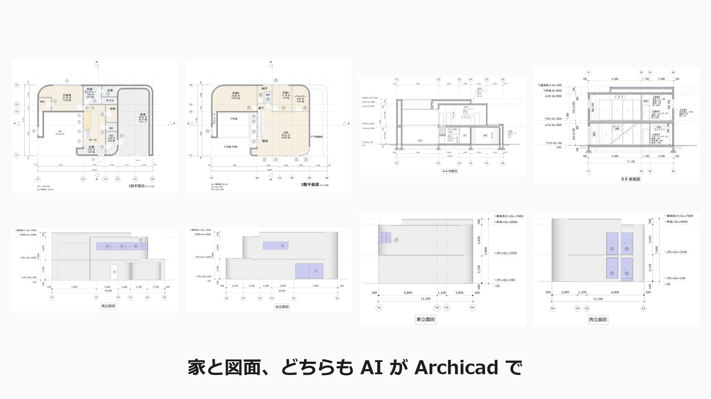
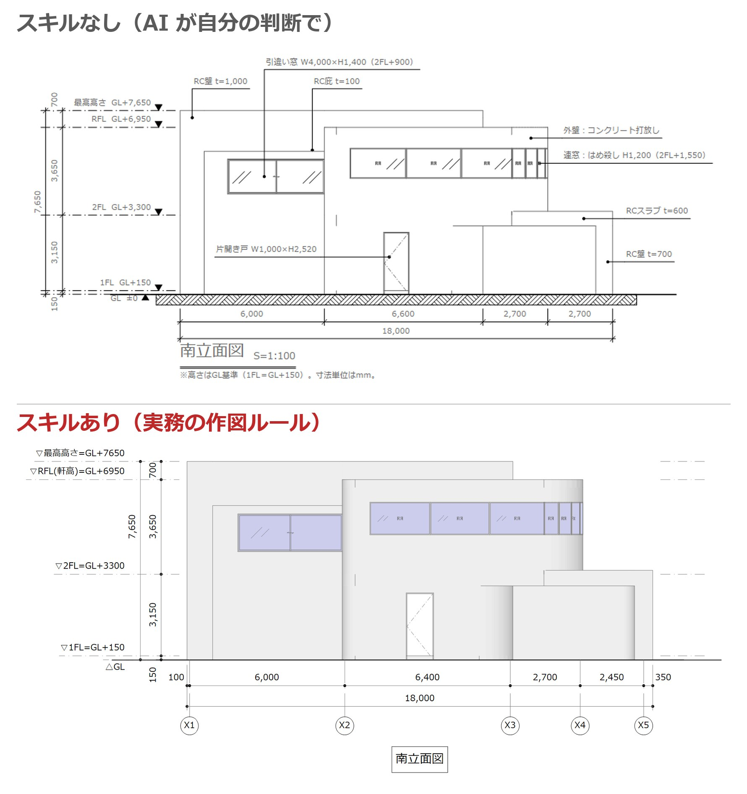
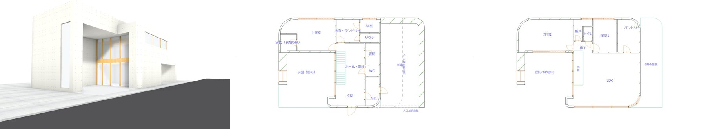
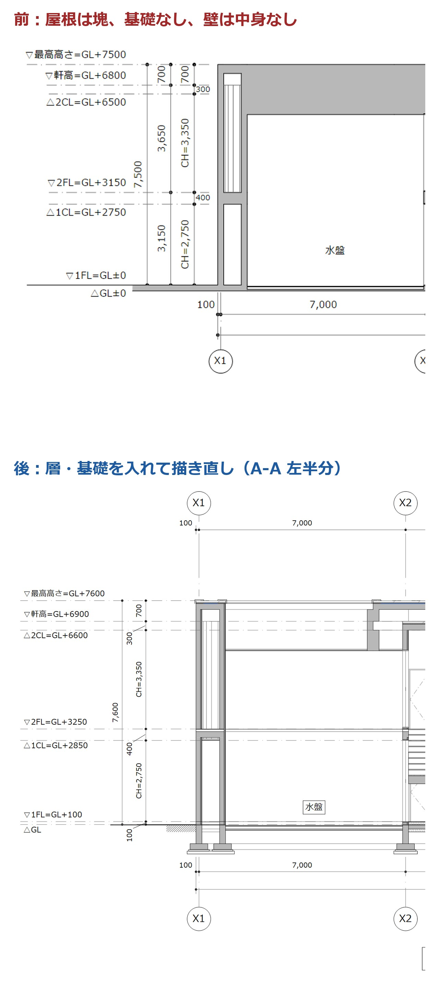
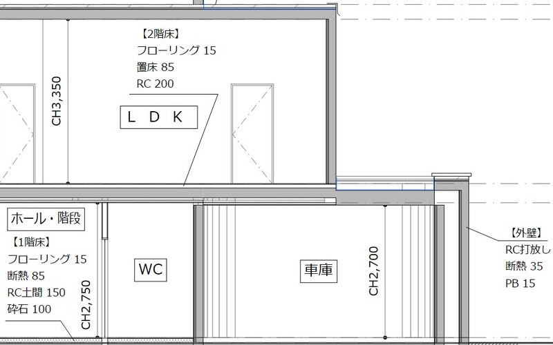

🇯🇵 日本語 | [🇺🇸 English](README.en.md)

# AI に1行ずつ頼むだけで、白紙の Archicad に家を組み、図面8枚まで描く

架空の家「打放しと水盤の家」（RC 2階建て）を、AI が白紙の Archicad に組み、平面2枚・断面2枚・立面4枚の計8枚を描いた実験の記録です。
同じことを自分で試せるように、必要な物を一式入れています。

**プログラムを書く必要はありません。** 最初の準備さえ済めば、あとは下の表の「1行」を AI に順に貼り、ところどころで Archicad の画面を少し操作するだけです。



## できるもの

- 白紙から組んだ家のモデル：壁・床・屋根・窓・扉・間仕切り・階段・部屋。断面に出るように、壁や床の層と基礎まで入れます。
- 図面8枚：1階・2階の平面図、A-A・B-B の断面図、東西南北の立面図。

**「描き方の決まり」を渡すと、図面が実務に近づきます。** 上が決まりなし、下が決まりあり（同じ南立面図。少し前の版の家）。
決まりありだと、高さは「▽2FL=GL+3250」の形にそろい、通り芯の丸が付き、寸法は通り芯から測ります。



## 用意するもの

- **Archicad**（日本語版の標準のテンプレートで試しました）
- **AI**：次のどちらか（どちらも有料プラン）
  - Claude の有料プラン ＋ Claude Code（デスクトップ版のアプリ）
  - ChatGPT の有料プラン ＋ Codex（デスクトップ版のアプリ）
- **最初の1回だけの準備（30〜60分）**：下の資料にある「AI への頼み文（プロンプト）」をコピーして AI に貼ると、AI が Archicad を AI から動かすための追加機能（Tapir）などを入れて、つないでくれます。
  - セットアップ資料：https://claude.ai/artifact/UwQrsxsWJztdwNVAd93t8T#ja
  - 講座のスライド：https://docs.google.com/presentation/d/11fd7nvZPuE5BPmIBTQYlUanp_OZPNibPhbAnpD_UStg/edit?usp=sharing
- **Rhino は要りません。** 元にする家のデータは Rhino の形式で書かれていますが、AI は中の数字を読むだけです。

## はじめに（1回だけ）

1. **このフォルダを手元に置く**：このページ（GitHub）の上の方の緑色の「Code」ボタン →「Download ZIP」。ZIP を開き、中の「experiments」→「2026-11_archicad-drawing-set」フォルダを、わかりやすい場所に置きます（AI に「GitHub の supertask/ai-architecture-lab をダウンロードして」と頼んでもかまいません）。
2. **AI のアプリで、作業するフォルダとして、1 のフォルダを選ぶ**（アプリによって「フォルダを開く」「プロジェクトを追加」など呼び方が違います）。以後の会話は、いつもこのフォルダで始めます。

## 進め方：表の順に、1行ずつ

実験では、AI に描かせる段は**新しい AI の会話に、「〜.md を読んで、指示どおりに作業してください」という1行だけを入れて**進めました（AI エージェントは Hermes Agent。皆さんは Claude Code か Codex）。
1行ごとに**新しい会話**を始めます（前の図の値を使い回さないためです）。AI は次の1行を教えてくれないので、この表を見ながら進めてください。

「実験で」の列は、その段を実験でどうしたかです。

- **同じ指示で実行**：実験で使った指示のファイルそのまま（場所とポートの書き方だけ置き換え）
- **同じスクリプトを実行（指示文は今回追加）**：実験では実験者の AI が直接スクリプトを流した段。同じスクリプトを同じ順に流すだけの短い指示を、公開用に足しました
- **人が手で**：Archicad の画面で人が操作する段
- **追加（未使用）**：公開用に足した物で、実験では使っていません

| 段 | 貼る1行（または、人がやること） | 何をするか | 実験で | 終わったら | 時間の目安 |
| --- | --- | --- | --- | --- | --- |
| 0 | 人：Archicad を起動し、ファイル › 新規 で空のプロジェクトを開く | — | 人が手で | 段 1 へ | 1分 |
| 1 | `prompts/00_prepare.md を読んで、指示どおりに作業してください` | つながりの確認、作業フォルダ（work）作り、階を 1FL・2FL・RFL にして work に「house_from_scratch」で保存 | 追加（未使用）※1 | AI が見せた出力に「NG」やエラーが無いか見る | 数分 |
| 2 | `work/prompts/01_model_M.md を読んで、指示どおりに作業してください` | 外壁・床・屋根・窓・扉を1つずつ置く | 同じ指示で実行 | Archicad で保存（ファイル › 保存） | 約14分 |
| 3 | `work/prompts/02_interior_I.md を読んで、指示どおりに作業してください` | 間仕切り・扉・階段・部屋。通り芯を1組決めて work の grid.json に書く | 同じ指示で実行 | 保存。work に grid.json ができたか見る | 約18分 |
| 4 | `work/prompts/05_sections.md を読んで、指示どおりに作業してください` | 立面用の線4本と、断面 A-A・B-B の線を作る | 同じスクリプトを実行（指示文は今回追加）※2 | 段 5 へ | 数分 |
| 5 | 人：ナビゲータ › プロジェクト一覧 › 断面図 の6つ（S南・S東・S北・S西・A-A・B-B）を、1回ずつダブルクリックして開く | 版によっては、作ったばかりの断面の窓を AI から開けないため | 人が手で | 保存 | 数分 |
| 6 | `work/prompts/06_fix_model.md を読んで、指示どおりに作業してください` | 壁・床・屋根を層のある部材に、基礎を足す、家ごと 100 上げて 1FL＝GL+100、前に描いた線や文字を消す（この順では、ふつう消す物は無い） | 同じスクリプトを実行（指示文は今回追加） | 保存 | 数分 |
| 7 | 8本を1本ずつ、それぞれ新しい会話で：`work/prompts/12_sheet_SA.md を読んで、指示どおりに作業してください` → `13_sheet_SB` → `14_sheet_ES` → `15_sheet_EN` → `16_sheet_EE` → `17_sheet_EW` → `10_sheet_P1` → `11_sheet_P2` | 作図ルールを読み、1枚ずつ描く（A-A・B-B 断面、南・北・東・西立面、1階・2階平面） | 同じ指示で実行（この順で） | **1枚ごとに保存**してから次の1行 | 1枚 12〜35分。8枚で約3時間 |
| 8 | 人：ナビゲータで「S-01 A-A」を右クリック →「断面図の名前を変更...」で参照ID を A に。「S-01 B-B」も B に | 平面図に出る断面記号を A・B にする（AI からは変えられない） | 人が手で ※3 | 保存 | 数分 |
| 9 | `work/prompts/18_export.md を読んで、指示どおりに作業してください` | 地中の部材（基礎など）を別の画層へ移し、8枚を画像に書き出す | 同じスクリプトを実行（指示文は今回追加） | このフォルダの `out` → `png` の8枚を見る | 5〜10分 |
| 10 | `work/prompts/30_inspect_and_fix.md を読んで、指示どおりに作業してください`（気づいた所を後ろに書き足す） | 点検して、直しの指示を書いて、直す（1周） | 追加（未使用） | 2〜3周で止める | 1周 約1〜1.5時間 |

- ※1 実験の白紙のプロジェクトは、この家の前の回のモデルを別名で保存して中身を空にした物で、階（1FL・2FL・RFL）はその時のままでした。段 1 の階の設定は、その前の回に送ったのと同じ設定です。つながりの確認と作業フォルダ作りは、公開用に足した物です。
- ※2 実験では、この線は前の回のモデルで同じ処理（このスクリプトの元になったスクリプト）で作り、白紙にしたプロジェクトに残っていた物を使いました。
- ※3 実験では、点検と直しの途中（直しの3回目と4回目の間）で変えました。
- 段 7 は、まとめて流すこともできます（`scripts/run_sheets.sh`。1本ずつ新しい AI に渡し、1枚ごとに保存する。使い方は [TECHNICAL.md](TECHNICAL.md)）。実験の連続実行と同じ形です。
- 段 10 で気づいた所は、1行のあとにふつうの言葉で書き足します。例：`work/prompts/30_inspect_and_fix.md を読んで、指示どおりに作業してください。A-A 断面図で、防水の青い線が笠木の上まで出ている`
- **この表の流れを、公開したキットで最初から最後まで通して試したことは、まだありません**（下の「正直に書いておくこと」）。

### 実験の記録として入れている指示（ふだんの順では使いません）

| ファイル | 中身 | 実験で |
| --- | --- | --- |
| `03_south_elevation_recorded.md` | 録画した南立面図の回（モデルを直す前の家） | 同じ指示で実行 |
| `04_fix_partition_F.md` | 屋根を突き抜けた間仕切りを直し、描き直すために一部の図の線を消した回 | 同じ指示で実行 |
| `20_`〜`22_`（A-A 断面図の直し 2〜4回目）、`23_`〜`25_`（1階平面図の直し） | 実験の直しの記録（そのときの失敗に合わせた指示。あなたの結果には当てはまらないことが多い） | 同じ指示で実行 |

## 各段の中身

### ① 家を組む（段 0〜3）

AI が読む家のデータは、このフォルダの `inputs` に入っています。左が外観（Rhino で作った家）、中・右が1階・2階の間取りの図（どちらも架空）。



- **AI がすること**：段 2 で、家のデータの数字を読み、1階の壁 → 2階の壁 → 床・屋根・地面 → 窓・扉 の順に1つずつ置きます。段 3 で、間取りの図を見て間仕切り・扉・階段・部屋を入れ、通り芯を1組決めてファイルに書きます。
- **画面に見えるもの**：Archicad の 3D の窓で、家が1つずつ組み上がっていきます。AI の画面には「1階の壁を作ります」のような1行が出ます。
- **終わったかの確かめ方**
  - [ ] 3D で、外壁・2階の床・屋根・窓・玄関扉・車庫・地面が見える（段 2）
  - [ ] 平面図に、間仕切り・扉・階段・部屋の名前がある（段 3）
  - [ ] AI が「完了」と書いた

### ② 図面を描く（段 4〜9）



- **AI がすること**：段 4 で、建物の外に立面用の線4本と、断面 A-A・B-B の線を引きます。段 6 で、断面にきちんと出るように、壁・床・屋根を層のある部材に変え、基礎を足し、家ごと 100 上げて 1FL＝GL+100 にします（上の図。実験では、最初は屋根が厚さ約1mの塊で基礎も無い「張りぼて」でした）。段 7 で、作図ルール（描き方の決まり）を1枚ごとに読み、通り芯・寸法・レベル・室名・塗りなどを描きます。段 9 で、8枚を画像に書き出します。
- **画面に見えるもの**：断面・立面の窓や平面図が切り替わり、線や文字が種類ごとに足されていきます。下は描き上がった A-A 断面図の一部です。



- **終わったかの確かめ方**
  - [ ] 段 6 のあと、断面図 A-A の窓で、屋根・床・壁に層の線が出て、基礎が見える
  - [ ] 8枚それぞれで AI が「完了」と書いた
  - [ ] このフォルダの `out` → `png` に `hi_P1.png` 〜 `hi_EW.png` の8枚がある。高さが「▽2FL=GL+3250」の形、通り芯の丸と名前がある

### ③ 点検して直す（段 10）

- **AI がすること**：8枚を画像と数値で確かめます（レベルの数字がモデルと合うか、寸法の合計が全長と合うか、文字が重なっていないか）。作図ルールと比べて、直す所を図ごとの指示に書き、1枚ずつ直します。
- **人がやること**：直してほしい所を、ふつうの言葉で書き足す。報告を見て、もう1周するかを決める。
- 実験では、この点検と直しの指示を実験者の AI が書き、20〜25 のような指示を1本ずつ流しました。段 10 の指示は、その作業を公開用に文章にした物で、実験では使っていません。

## 困った時

| こんな時 | やること |
| --- | --- |
| 「Archicad が見つからない」「ポート」「NG」と出た | Archicad が起動して、プロジェクトが開いているかを確かめ、同じ1行をもう一度。だめなら、最初の準備（セットアップ資料）がまだです。 |
| AI がエラーで止まった | 出力をそのまま AI に見せて、何が起きたか聞く。同じ段の1行を流し直す前に、途中まで進んだかを確かめる（段 6・9 のスクリプトには、2回流すと2回上がる・下がる物があります）。 |
| Archicad が落ちた | Archicad を開き直し、`work` フォルダの「house_from_scratch」を開く（復元を聞かれたら「いいえ」）。最後に保存した所から、表の続きの1行を新しい会話で。 |
| 図の文字や線が重なっている | 段 10 の1行のあとに、場所と様子を書く。例：「1階平面図で、車庫の面積の文字が X5 の通り芯に重なっている」 |

## 時間と費用

| 頼むこと | AI の作業時間（実験の記録から） |
| --- | --- |
| ① 家を組む | 外形 約14分 ＋ 間取り 約18分 |
| ② 図面を描く | 線と層・基礎の直しはスクリプトで数分 ＋ 8枚 約3時間（断面 30〜35分／枚、立面 14〜19分／枚、平面 12〜26分／枚） |
| ③ 点検して直す | 1回 約1〜1.5時間（1枚 5〜30分）。実験では2〜3回 |

ほとんどは AI が考えている時間で、人は待つだけです。AI は契約している Claude か ChatGPT のプランの範囲で使います。作業が長いので、プランによっては途中で使える量の上限に届くことがあります。その時は時間をおいて、同じ1行をもう一度送ってください。

## まったく同じにはならないこと

- **AI の答えは毎回違います。** 線や文字の位置、間取りの細部は、回ごとに変わります。ここに載せた図と同じにはなりません。
- **見本にした実務の図面は公開していません。** 図面から整理した「描き方の決まり」（作図ルール）の文章だけを入れています。
- **Archicad の言語やテンプレートが違うと、止まることがあります。** 材料の名前（「コンクリート」など）を、日本語の標準テンプレートの名前で使っているためです。

## 自分の事務所で使うには

AI に渡した「描き方の決まり」（作図ルール）は、「rules」フォルダに入っている**ふつうの日本語の文章**です。プログラムではありません。たとえば断面図のルールには、こう書いてあります。

> **レベル**
> - 書式：▽名称=GL+数値（カンマなし・単位なし）。GL は △GL。
> - ▽（上面：最高高さ・軒高・各FL）は文字を線の上、△（天井 CL と GL）は文字を線の下。
>
> **地盤**：GL は細い実線を建物の左右に長めに。建物の外側に、幅 1m ほどの土の斜線の帯を GL の下に入れる（建物の下には入れない）。

これを**自分の事務所の描き方に書き換えれば、それがそのまま自分の事務所のスキル（AI に渡す手順書）になります。** 書き換えも AI に頼めます。

```
rules フォルダの断面図のルールを、この事務所の断面図の描き方に合わせて書き換えて。見本はこのフォルダに置いた PDF。形や間取りは写さず、描き方だけを書いて
```

**育て方**：描かせて、点検して、見つかった失敗をルールの最後の「前回の失敗」の欄に足していきます。実験では、たとえばこう足しました。

> - 防水の青線を、笠木の上面や向こうに見える箱の上面に引いた。→ 青線は切断した屋根スラブの RC の上面と、パラペットの内側の立上りだけ。笠木の下で止める。
> - 小さい寸法（300・400・100）がレベルの一点鎖線と重なった。→ 引き出して空いた所に書く。

ルールは全部を一度に渡すより、描く図の種類の分だけを渡す方がよく守られます（各段の指示がそうなっています）。

## 正直に書いておくこと

- **通しでは試していません**：表の段 2・3・7 の指示（01・02・10〜17）と、記録の 03・04・20〜25 は、実験で実際に「〜.md を読んで、指示どおりに作業してください」の1行で、新しい会話の AI（Hermes Agent ＋ Claude Opus 5.5）に流した物そのままです。段 1・4・6・9 の短い指示は、実験者の AI が直接流したスクリプトを同じ順に流すだけの物ですが、指示文としては新しく、段 10 は実験では使っていません。この表の流れを公開したキットで最初から最後まで流したことはなく、Claude Code・Codex でも試していません。つまずいた所があれば教えてください。
- 録画して時間を測ったのは、家の外形を組む所（約14分）と、南立面図1枚（約10分）だけです。ほかの時間は、作業の始まりと終わりの時刻から読んだ目安です。録画した南立面図は、層と基礎を入れる前の版で、上の8枚の南立面図とは違います。
- 8枚が今の形になるまでに、断面図・立面図は3回、平面図は2回直しています。1回で仕上がったわけではありません。
- 点検と直しの指示は、実験で使った AI エージェント（Hermes Agent。AI にパソコン上の作業をさせる道具）が書きました。壁・床・屋根の層と基礎を入れる直しも、同じ AI がスクリプトで行いました。
  AI が描いた線のほかに、Hermes が直接直した所が3つあります：断面記号の名前を A・B に変えた、立面図・平面図を書き出す時に地中（基礎）の画層を隠した、AI が小さい部屋に足した面積の表示（かえって分かりにくくなった物）を外した。
- 残っている弱い所：車庫の壁が二重に見える／1階平面図にスラブの角の円弧が見える／A-A 断面図の梁の所に小さい白いすき間がある／X6 通りの基礎にすき間がある。
- 寸法は線と文字で描いたもので、モデルを変えても追従しません（次の実験で扱います）。
- 8枚を続けて描いている間に、Archicad が2回落ちました。そのため1枚ごとに保存するようにしています。
- 作図ルールは、実務の図面の描き方（作法）だけを整理したもので、形・間取り・数値は写していません。家は架空です。1回ずつの試行なので、AI や回数を変えると結果は変わります。
- 使ったもの：AI は Claude Opus 5.5（Hermes Agent 経由）、ソフトは Archicad と Tapir。2026年11月15〜16日。

## 詳しい人・AI 向け

- [AI_GUIDE.md](AI_GUIDE.md)：AI 向けの索引
- [prompts/](prompts/)：各段の指示（上の表の1行で AI が読むファイル）
- [TECHNICAL.md](TECHNICAL.md)：入っているファイルの一覧、実験でやった順、モデルの直し方、スクリプト（AI が書いた小さなプログラム）の出どころ
- [skills/](skills/README.md)：Archicad を動かすコツと、点検のやり方（AI 向け）
- [rules/](rules/README.md)：作図ルール（平面・断面・立面）
- 解説記事の元原稿：[docs/2026-11-16-archicad-drawing-set.md](../../docs/2026-11-16-archicad-drawing-set.md)
