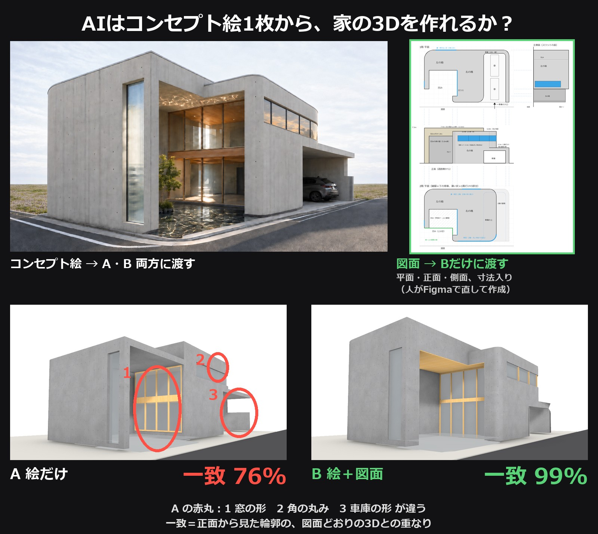
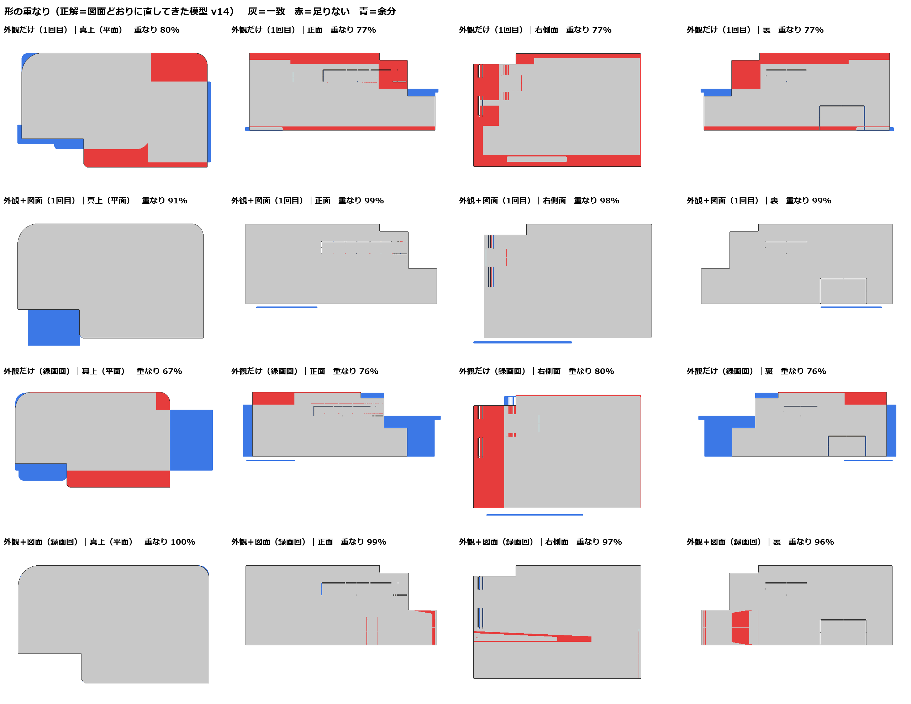
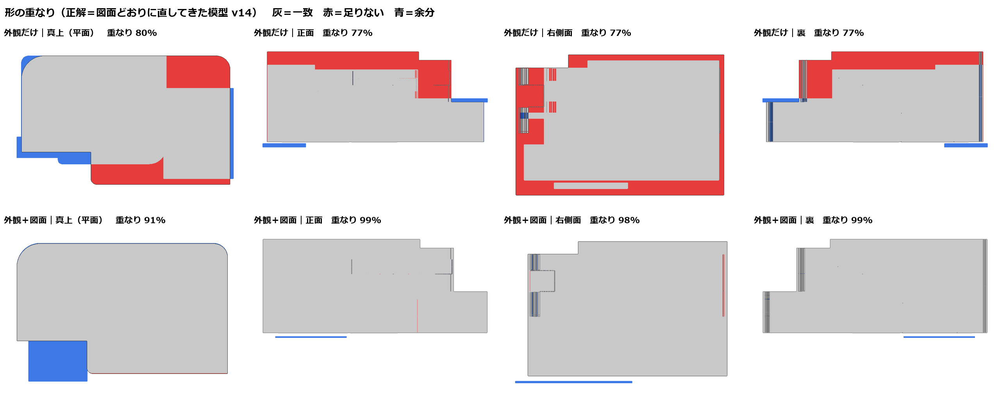
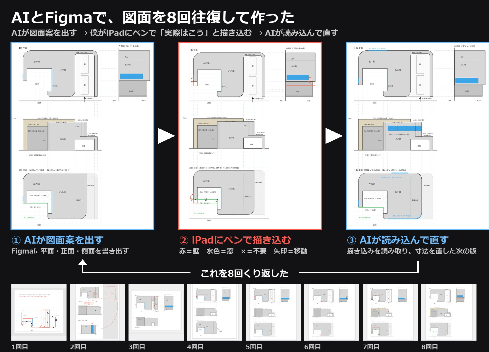
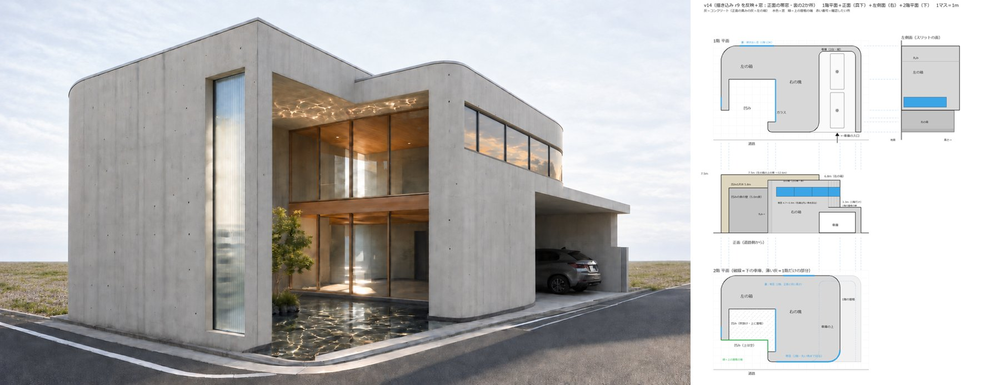

[🇯🇵 日本語](README.md) | 🇺🇸 English

# Can an AI build a house in 3D from one exterior image? — image only vs image + drawings (reproduction kit)

We gave an AI the same fictional house either as one exterior image only (A) or as the image plus simple drawings (B), had it build a Rhino model, and compared the model's shape with the correct model.
Everything you need to try it yourself is in this folder. **You do not need to write any code.** After the setup, you just paste the "one line" from the table below into the AI, step by step.

Article (note, Japanese): https://note.com/supertask/n/n69f258b2f66e



## Results

We captured the correct model and the AI's models from the top, front, right side and back under identical conditions (below we call these outline-only images "silhouettes") and computed the overlap ratio of the outlines (overlapping area ÷ area covered by either). 100% means the shapes are identical.

**Run where the AI assembled the model part by part in Rhino (the recorded run, 2026-11-04)**: the headline numbers in the note article (image only 68–80%, with drawings 96–100%) are from this run.

| View | A image only | B image + drawings |
| --- | --- | --- |
| Top | 68% | 100% |
| Front | 76% | 99% |
| Right side | 80% | 97% |
| Back | 76% | 96% |



**Run where the AI only wrote the model script (a small program that builds the model) (2026-11-04, one trial each)**

| View | A image only | B image + drawings |
| --- | --- | --- |
| Top | 80% | 91% |
| Front | 77% | 99% |
| Right side | 77% | 99% |
| Back | 77% | 99% |



- With the image only (A), the AI has to assume a scale cue (the height of the camera that took the picture). It assumed 2.1 m in the first run and 1.62 m in the second, and the shape changed each time.
- With image + drawings (B), everything that was on the drawings was accurate in both runs. The deviations were in things not on the drawings (around the single-storey part at the right end, the material of the recess ceiling).

**The drawings given to B were made by the AI and a human going back and forth 8 times in Figma (a browser app for drawing and sharing).** The AI proposed a drawing, the human marked it up with an iPad pen ("this is a wall", "this window goes here"), and the AI drew the next version. The process can be viewed on the Figma board (view only).

[](https://www.figma.com/board/Fajd8nO7JFtNX5Ty2JOus4)

## What you need

- **Rhino**
- **An AI**, one of these (both paid plans):
  - a paid Claude plan + Claude Code (desktop app)
  - a paid ChatGPT plan + Codex (desktop app)
- **One-time setup (30–60 min)**: copy the "prompt for the AI" from the setup page below and paste it into the AI; it prepares the connection to Rhino.
  - Setup page: https://claude.ai/artifact/UwQrsxsWJztdwNVAd93t8T#en
  - Workshop slides (Japanese): https://docs.google.com/presentation/d/11fd7nvZPuE5BPmIBTQYlUanp_OZPNibPhbAnpD_UStg/edit?usp=sharing
  - You can proceed without the connection: the AI then only writes the model script, and at capture time asks you to "open and run this file in Rhino".

## Getting started (once)

1. **Get this folder**: on this GitHub page, click the green "Code" button → "Download ZIP". Unzip it and put "experiments" → "2026-11_image-vs-drawing-3d" somewhere easy to find. (Or ask the AI: "Download supertask/ai-architecture-lab from GitHub".)
2. **Start Rhino.**
3. **In the AI app, choose the folder from step 1 as the working folder.**

## How to run it: paste one line per step

In the experiment, too, the models were built by **pasting a single line — "Read … and follow its instructions" — into a fresh AI conversation**. The only difference is that the experiment used the Hermes Agent AI agent; you use Claude Code or Codex.

This folder **also contains the correct model**. So that the model-building AI cannot see the answer, steps 1 and 3 start a new conversation in a separate folder, created by the AI, that contains only the image and the instructions.

| Step | Working folder | Line to paste | What happens | Time |
| --- | --- | --- | --- | --- |
| 0 | this folder | `Read prompts/00_prepare_A.md and follow its instructions.` | Creates the folder "ai-run-A" for A next to this folder | a few min |
| 1 | **ai-run-A** (new conversation) | `Read prompt.md and follow its instructions.` | The AI looks only at the image, decides dimensions and builds the model | 15–40 min |
| 2 | this folder | `Read prompts/00_prepare_B.md and follow its instructions.` | Creates the folder "ai-run-B" for B | a few min |
| 3 | **ai-run-B** (new conversation) | `Read prompt.md and follow its instructions.` | The AI looks at the image and the drawings and builds the model | 15–40 min |
| 4 | this folder | `Read prompts/10_shoot_and_score.md and follow its instructions.` | Captures the correct model, A and B with the same camera and computes the overlap | 15–20 min |
| — | this folder | `Read prompts/11_check_scoring.md and follow its instructions.` | (Without Rhino) only checks the scoring method; gives the same numbers as the recorded run | 5–10 min |

- Do not give the conversations of steps 1 and 3 anything about this kit or any other material (it changes the conditions). Run A and B in separate conversations with the same AI.
- The prompt for steps 1 and 3 (`prompt.md`) is the verbatim prompt given to the model-building AI in the experiment (in English; only folder locations replaced, plus one closing sentence telling the user to go back to the first conversation). The prompts for steps 0, 2, 4 and the scoring check were written for the public kit: they put into words the preparation, capture and scoring that the experimenter's AI did directly, so that one line is enough. **The scoring check (last row) was verified to give the same numbers this way. Steps 0–4 have not yet been run end-to-end.**

## What happens in each step

### Building the models (steps 0–3)



- **What the AI does**: in steps 0 and 2 it checks whether it can drive Rhino; if yes, it uses the "build part by part in Rhino" form (same as the recorded run), if not, the "write the script only" form, and it creates the input-only folder. In steps 1 and 3 the AI looks at the image (and drawings) many times, decides dimensions and builds in this order: ground and road → main volumes → recess → windows → timber parts → carport → pool → hidden back sides. Finally it writes the model script, a list of assumed dimensions and notes.
- **What you see**: in the Rhino form, the house goes up part by part in Rhino; the AI prints lines like "Left box: width 7.0 m, depth 8.0 m, height 7.0 m (estimated from a 4.5 m car)". In the script form, the AI crops and studies the image while writing the script.
- **How to tell it finished correctly**
  - [ ] The AI ended with a summary and its "least certain assumptions"
  - [ ] The output folder inside ai-run-A (B) (`A_out` or `outputs/A`) contains `model.py`, `params.json` and `notes.md`

### Capture and score (step 4)

- **What the AI does**: collects the models and captures the correct model, A and B one after another with the same Rhino window state (the exterior's camera angle, the back, and silhouettes from top/front/right/back). It overlays the silhouettes and makes a table of overlap ratios and comparison images.
- **What you do**: do not resize the Rhino window during capture (that changes the scale of the parallel views and breaks the overlap). If the AI cannot drive Rhino, open the file it asks for in Rhino's ScriptEditor and run it.
- **How to tell it finished correctly**
  - [ ] A table of overlap ratios for the 4 views was shown, next to the published values
  - [ ] There are comparison images in `work` → `results_mine` in this folder

## Troubleshooting (what to tell the AI)

| Situation | What to say / do |
| --- | --- |
| The AI says it cannot drive Rhino | That is fine (it uses the script form; you only run one file at capture time). To connect, do the one-time setup (setup page). |
| Walls of the model disappeared / the shape looks wrong | The step-4 AI checks the face orientation and fixes it (without changing dimensions). If not, add: "The walls disappeared. Check the face orientation." |
| The overlap is suddenly low (e.g. 30-something %) | The Rhino window was probably resized during capture. Leave the window as is and paste the step-4 line again. |
| Model building stopped midway | Tell that conversation "please continue". If that fails, start a new conversation in ai-run-A (B) and paste the same line. |
| Continuing the next day | Start a new conversation in this folder and ask: "Read work/progress.md and tell me the next line to paste." |

## Time

| Task | Time |
| --- | --- |
| Connecting the AI to Rhino (first time only) | 30–60 min |
| Having the AI build A and B | 15–40 min each (AI working time; you just wait) |
| Capture in Rhino (correct model, A, B) | 5–10 min |
| Scoring and comparison sheets | a few min |
| Remaking the facade textures (optional) | 30 min+ (including image generation) |
| Remaking the drawings via the Figma loop (optional) | 8 rounds this time; hours to days, as human judgement is involved |

## Cost

The AI runs within your Claude or ChatGPT plan. Only if you remake the facade textures do you also use an image-generation service (ComfyUI cloud) (optional).

## What will not be identical

- **AI answers change every time.** Even with the same prompt, the assumed dimensions (e.g. eye height) change, and A's overlap moves by a few points per run. Look at the trend (A around 70–80%, B in the 90s).
- **AIs get updated.** These are results with Claude Opus 5.5 on 4–5 November 2026.
- **Making the drawings is human judgement itself.** If you do the loop yourself you get different drawings. To test B under the same conditions, use the bundled drawings as they are (the step-2 prompt does this).
- **Image generation does not reproduce the same pixels.** The exterior image and the facade textures used in the comparison are bundled as finished files.
- **The script-run numbers can differ by up to 0.5 points when recomputed from the bundled silhouettes** (the correct model's silhouettes were re-captured after scoring; the recorded run matches exactly).

## Use it in your own work

The working procedures of this experiment are in the "skills" folder as **plain prose** (procedure documents for the AI, in Japanese; see [skills/README.en.md](skills/README.en.md)).

- Build a Rhino volume model from an exterior image or photo
- The AI puts a drawing draft on Figma, a human marks it up with a pen, the AI draws the next version (how B's drawings were made)
- Make facade textures with image generation and prepare them for Rhino
- Compare inputs fairly, like image only vs image + drawings

To try it with your own exterior rendering or sketch, you could ask:

```
Read skills/image-to-massing.md in this folder, then build a Rhino volume model from this exterior rendering.
```

What the results say: **to get an AI to build a shape accurately, you need drawings.** It read what was on the drawings almost exactly, and missed things that were not on them (materials, "this is a wall", etc.).

## Honest notes

- **The one-line-per-step flow**: model building (steps 1 and 3) was done in the experiment by pasting one line into a new conversation, too. The prompts for steps 0, 2 and 4 were written for publication and have not been run end-to-end, nor tried with Claude Code or Codex. The scoring check (without Rhino) was verified to reproduce the published numbers from the bundled silhouettes.
- A's model, as written, made the walls disappear (the solids' faces pointed inward). Only three lines fixing the orientation were added before running it (dimensions unchanged).
- The correct model is itself built from the drawings, so the comparison favours B, which received the drawings.
- One trial each. Results vary with other AIs or more runs.
- The house is fictional (made from an AI image).
- Used: AI Claude Opus 5.5 (via the AI agent Hermes Agent — a tool that lets an AI work on a computer), Rhino, Figma + iPad, facade textures with ComfyUI (Qwen-Image 2.1).

## For advanced users and AIs

- [AI_GUIDE.en.md](AI_GUIDE.en.md): the guide for AI agents. Prompt files per step and shared rules, the file list, capture and scoring details, what was done in the experiment, how the facade textures were made, how to adjust file locations, and pointers to the prompts and working procedures (skills) are all there
