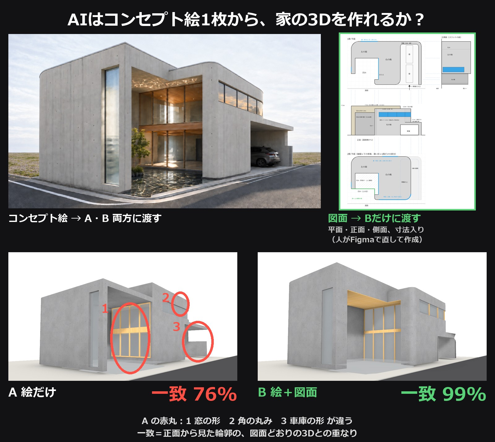
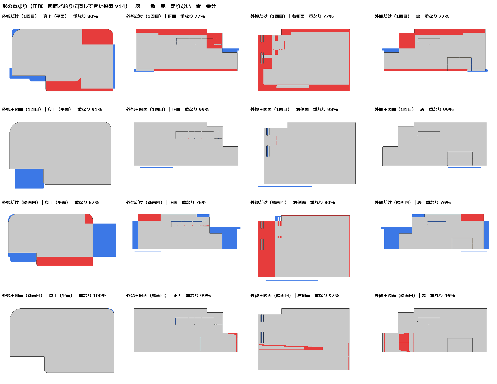
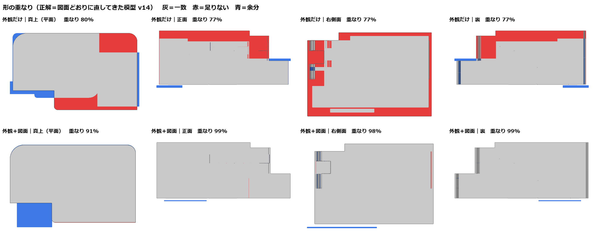
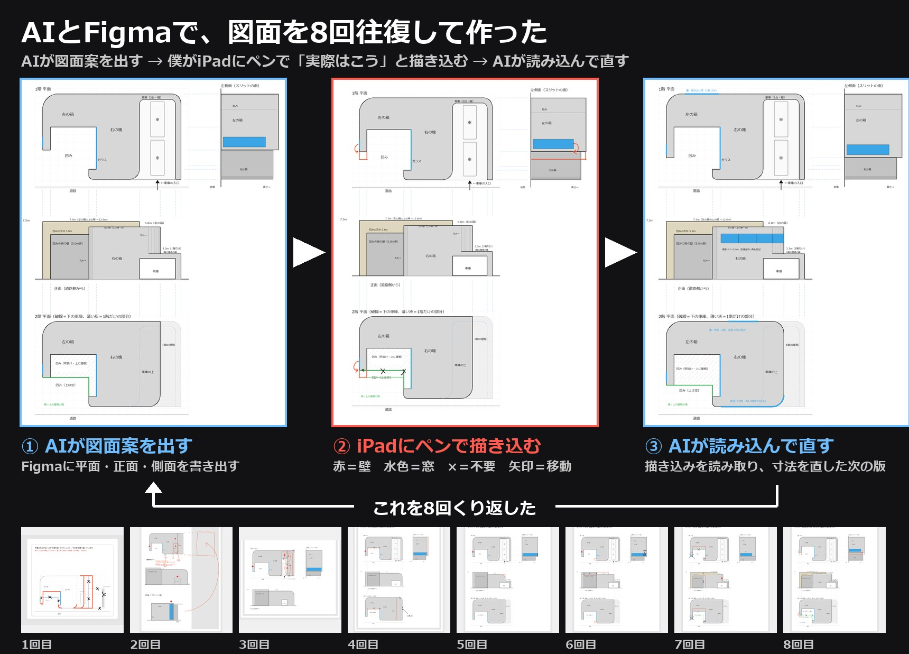
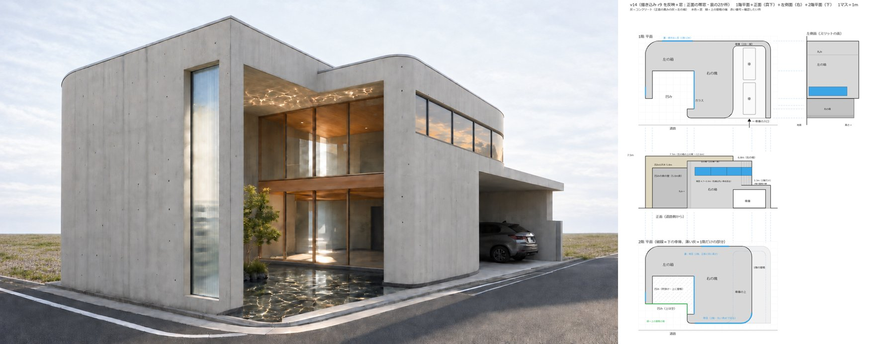

🇯🇵 日本語 | [🇺🇸 English](README.en.md)

# AI は外観の絵1枚から、家の3Dを起こせるか — 絵だけ vs 絵＋図面（再現キット）

同じ架空の家を、外観の絵1枚だけ（A）と、絵＋簡単な図面（B）で AI に渡し、Rhino の模型を作らせて、正解の模型との形の重なりを比べた実験です。
同じことを自分で試せるように、必要な物を一式入れています。**プログラムを書く必要はありません。** 準備が済めば、下の表の「1行」を AI に順に貼るだけです。

解説記事（note）：https://note.com/supertask/n/n69f258b2f66e



## 結果

正解の模型と、AI が作った模型を、真上・正面・右側面・裏から同じ条件で撮り（この輪郭だけの画像を、以下「影絵」と呼びます）、輪郭の重なり率（重なった面積 ÷ どちらかが占める面積）を出しました。100% なら形がぴったり同じです。

**AI が Rhino で部分ごとに組み立てた回（録画した回、2026-11-04）**：note の見出しの数値（絵だけ 68〜80%、図面あり 96〜100%）はこの回のものです。

| 見る向き | A 外観だけ | B 外観＋図面 |
| --- | --- | --- |
| 真上 | 68% | 100% |
| 正面 | 76% | 99% |
| 右側面 | 80% | 97% |
| 裏 | 76% | 96% |



**AI に模型のスクリプト（模型を作るための小さなプログラム）を書かせただけの回（2026-11-04、1回ずつ）**

| 見る向き | A 外観だけ | B 外観＋図面 |
| --- | --- | --- |
| 真上 | 80% | 91% |
| 正面 | 77% | 99% |
| 右側面 | 77% | 99% |
| 裏 | 77% | 99% |



- 絵だけ（A）は、大きさの手がかり（絵を撮ったカメラの高さ）を AI が仮定します。1回目は 2.1m、2回目は 1.62m と仮定が変わり、形も毎回変わりました。
- 絵＋図面（B）は、2回とも図面に書いてある所は正確でした。ずれたのは図面に無い所（右端の平屋のまわり、凹みの天井の素材）です。

**B に渡した図面は、AI と人が Figma（ブラウザで使える作図・共有のアプリ）で8回やりとりして作りました。** AI が図面案を出し、人が iPad のペンで「ここは壁」「この窓はこちら」と描き込み、AI が次の版を描く、のくり返しです。過程は Figma のボードで見られます（閲覧のみ）。

[](https://www.figma.com/board/Fajd8nO7JFtNX5Ty2JOus4)

## 用意するもの

- **Rhino**
- **AI**：次のどちらか（どちらも有料プラン）
  - Claude の有料プラン ＋ Claude Code（デスクトップ版のアプリ）
  - ChatGPT の有料プラン ＋ Codex（デスクトップ版のアプリ）
- **最初の1回だけの準備（30〜60分）**：下の資料にある「AI への頼み文（プロンプト）」をコピーして AI に貼ると、AI が Rhino とつなぐ準備をしてくれます。
  - セットアップ資料：https://claude.ai/artifact/UwQrsxsWJztdwNVAd93t8T#ja
  - 講座のスライド：https://docs.google.com/presentation/d/11fd7nvZPuE5BPmIBTQYlUanp_OZPNibPhbAnpD_UStg/edit?usp=sharing
  - つながっていなくても進めます。AI は模型のスクリプトを書くだけの形式になり、撮影の時に「Rhino でこのファイルを開いて実行して」と頼んできます。

## はじめに（1回だけ）

1. **このフォルダを手元に置く**：このページ（GitHub）の上の方の緑色の「Code」ボタン →「Download ZIP」。ZIP を開き、中の「experiments」→「2026-11_image-vs-drawing-3d」フォルダを、わかりやすい場所に置きます（AI に「GitHub の supertask/ai-architecture-lab をダウンロードして」と頼んでもかまいません）。
2. **Rhino を起動しておく**。
3. **AI のアプリで、作業するフォルダとして、1 のフォルダを選ぶ**。

## 進め方：1段ごとに「1行」を貼る

実験でも、模型づくりは**新しい AI の会話に、「〜を読んで、その指示どおりに作業してください」という1行だけを入れて**行いました。違いは、実験では AI エージェントに Hermes Agent を使い、皆さんは Claude Code か Codex を使うことだけです。

このフォルダには**正解の模型も入っています**。模型を作る AI が答えを見ないように、段 1・3 では、AI が別の場所に作った「絵と指示だけ」のフォルダで、新しい会話を始めます。

| 段 | 作業フォルダ | 貼る1行 | 何をするか | 時間の目安 |
| --- | --- | --- | --- | --- |
| 0 | このフォルダ | `prompts/00_prepare_A.md を読んで、指示どおりに作業してください` | A 用のフォルダ「ai-run-A」を、このフォルダの隣に作る | 数分 |
| 1 | **ai-run-A**（新しい会話） | `prompt.md を読んで、指示どおりに作業してください` | AI が絵だけを見て寸法を決め、模型を作る | 15〜40分 |
| 2 | このフォルダ | `prompts/00_prepare_B.md を読んで、指示どおりに作業してください` | B 用のフォルダ「ai-run-B」を作る | 数分 |
| 3 | **ai-run-B**（新しい会話） | `prompt.md を読んで、指示どおりに作業してください` | AI が絵と図面を見て模型を作る | 15〜40分 |
| 4 | このフォルダ | `prompts/10_shoot_and_score.md を読んで、指示どおりに作業してください` | 正解・A・B を同じカメラで撮り、重なり率を出す | 15〜20分 |
| — | このフォルダ | `prompts/11_check_scoring.md を読んで、指示どおりに作業してください` | （Rhino 無しで）採点のしかただけ確かめる。録画した回と同じ値が出る | 5〜10分 |

- 段 1・3 の会話には、このキットの話や、ほかの資料を渡さないでください（条件が変わるため）。A と B は別々の会話で、同じ AI で行います。
- 段 1・3 の指示（`prompt.md`）は、実験で模型を作った AI に渡した指示の原文です（場所だけ置き換え。最後に「終わったら元の会話に戻るよう伝える」1文を足しています）。段 0・2・4 と採点の確かめの指示は、実験では実験者の AI が直接行った準備・撮影・採点を、同じ1行で済むように公開用に書いた物です。**採点の確かめ（最後の行）は、この手順で同じ値が出ることを確かめました。段 0〜4 を通しで流す試しは、まだしていません。**

## 各段の中身

### 模型を作る（段 0〜3）



- **AI がすること**：段 0・2 で、Rhino を AI から動かせるかを確かめ、動かせれば「Rhino で部分ごとに組む」形式（録画した回と同じ）、無ければ「スクリプトを書くだけ」の形式で、入力だけのフォルダを作ります。段 1・3 の AI は、絵（と図面）を何度も見て寸法を決め、地面と道路 → 大きな箱 → 凹み → 窓 → 木の部分 → カーポート → 水盤 → 見えない裏側 の順に作ります。最後に、模型のスクリプト・仮定した寸法の一覧・メモを書きます。
- **画面に見えるもの**：Rhino 形式なら、Rhino の画面で家が部分ごとに組み上がります。AI の画面には「左の箱：幅7.0m 奥行8.0m 高さ7.0m（車の長さ4.5mから推定）」のような1行が出ます。スクリプト形式なら、AI が絵を切り抜いて見ながら、スクリプトを書きます。
- **終わったかの確かめ方**
  - [ ] AI が、まとめと「確信の低い仮定」を書いて終わった
  - [ ] ai-run-A（B）の中の出力のフォルダ（`A_out` または `outputs/A`）に、`model.py`・`params.json`・`notes.md` がある

### 撮って、採点する（段 4）

- **AI がすること**：模型を集め、正解・A・B を、同じ Rhino の画面の状態で続けて撮ります（外観と同じ角度、裏、真上・正面・右側面・裏の影絵）。影絵を重ねて、重なり率の表と比較の画像を作ります。
- **人がやること**：撮影の間、Rhino の窓の大きさを変えない（変わると写る縮尺が変わり、重なり率がくずれます）。AI が Rhino を動かせない時は、AI に頼まれたファイルを Rhino の ScriptEditor で開いて実行します。
- **終わったかの確かめ方**
  - [ ] 4方向の重なり率の表が出た。公開した値と並べてある
  - [ ] このフォルダの `work` → `results_mine` に比較の画像がある

## 困った時（AI にこう言う）

| こんな時 | AI に言うこと・やること |
| --- | --- |
| AI が Rhino を動かせないと言う | そのままで大丈夫です（スクリプト形式で進み、撮影の時だけファイルを1つ実行します）。つなぎたい時は、最初の準備（セットアップ資料）を済ませます。 |
| 模型の壁が消えている・形がおかしい | 段 4 の AI が面の向きを確かめて直します（寸法は変えません）。直らない時は「壁が消えている。面の向きを確かめて」と書き足す。 |
| 重なり率が急に低い（30% 台など） | 撮影中に Rhino の窓の大きさが変わった可能性があります。窓をそのままにして、同じ1行（段 4）をもう一度。 |
| 模型づくりが途中で止まった | その会話に「続けてください」。だめなら ai-run-A（B）で新しい会話を始め、同じ1行。 |
| 次の日に続きをやりたい | このフォルダで新しい会話を始め、「work/progress.md を読んで、次に貼る1行を教えて」と頼む。 |

## 時間の目安

| 工程 | 時間 |
| --- | --- |
| AI と Rhino の接続（初回だけ） | 30〜60分 |
| A・B を AI に作らせる | 1件 15〜40分（AI の作業時間。人は待つだけ） |
| Rhino で撮影（正解・A・B） | 5〜10分 |
| 採点・比較シート | 数分 |
| 外壁の質感（テクスチャ）を作り直す（任意） | 30分〜（画像生成の時間込み） |
| 図面を Figma で往復して作り直す（任意） | 今回は8往復。人の判断が入るので数時間〜数日 |

## 費用

AI は、契約している Claude か ChatGPT のプランの範囲で使います。外壁の質感を作り直す場合だけ、画像生成のサービス（ComfyUI のクラウド版）を別に使います（任意）。

## まったく同じにはならないこと

- **AI の答えは毎回変わります。** 同じ指示でも寸法の仮定（目の高さなど）が変わり、A の重なり率は回ごとに数ポイント動きます。傾向（A は 70〜80% 前後、B は 90% 台）を見てください。
- **AI は更新されます。** 2026年11月4〜5日の Claude Opus 5.5 での結果です。
- **図面づくりのやりとりは、人の判断そのものです。** 自分でやりとりすれば違う図面になります。B を同じ条件で試す時は、同梱の図面をそのまま使います（段 2 の指示がそうします）。
- **画像生成は、同じ絵になりません。** 外観の絵と、比較に使った外壁の質感は、できあがった物を同梱しています。
- **スクリプトを書かせた回の数値は、同梱の影絵で計算し直すと最大 0.5 ポイントずれます**（採点のあとで正解の影絵を撮り直したため。録画した回は完全に一致します）。

## 自分の仕事で使うには

この実験の作業手順は、「skills」フォルダに**ふつうの日本語の文章**（AI に渡す手順書）として入っています。

- 外観の絵や写真から、Rhino のボリューム模型を起こす
- AI が図面案を Figma に置き、人がペンで描き込み、AI が次の版を描く（B の図面の作り方）
- 画像生成で外壁の質感を作り、Rhino で使える形にそろえる
- 絵だけ／絵＋図面のように、入力を変えて公平に比べる

自分の外観パースやスケッチで試す時は、たとえばこう頼めます。

```
skills フォルダの image-to-massing.md を読んで、この外観パースから Rhino でボリューム模型を起こして
```

結果から言えるのは、**AI に正確に形を起こさせるには図面が要る**ということです。図面に書いた所はほぼ正確に読み、書いていない所（素材、「ここは壁」など）で外れました。

## 正直に書いておくこと

- **1行ずつの再現の流れ**：模型づくり（段 1・3）は、実験でも新しい会話に1行だけを入れて行いました。段 0・2・4 の指示は公開用に書いた物で、通しでは流していません。Claude Code・Codex でも試していません。採点の確かめ（Rhino 無し）は、同梱の影絵から公開した値と同じ値が出ることを確かめました。
- A の模型は、そのままだと壁が消えました（立体の面の向きが内向きだったため）。向きを直す3行だけを足して実行しました（寸法は変えていません）。
- 正解も図面どおりの模型なので、図面を渡した B に有利な比べ方です。
- 1回ずつの試行です。AI や回数を変えると結果はぶれます。
- 家は架空です（AI 画像から作りました）。
- 使ったもの：AI は Claude Opus 5.5（AI エージェント Hermes Agent 経由。AI にパソコン上の作業をさせる道具）、Rhino、Figma ＋ iPad、外壁の質感は ComfyUI（Qwen-Image 2.1）。

## 詳しい人・AI 向け

- [AI_GUIDE.md](AI_GUIDE.md)：AI 向けの手引き。各段の指示ファイルと共通の決まり、入っているファイルの一覧、撮影と採点の細部、実験でやったこと、外壁の質感の作り方、ファイルの置き場所の読み替え、指示（prompts）・作業手順（skills）への案内は、すべてここにあります
