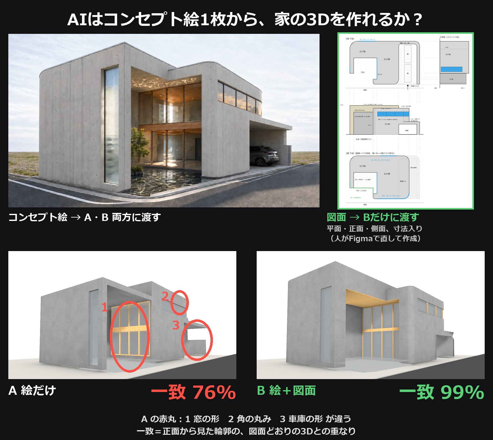
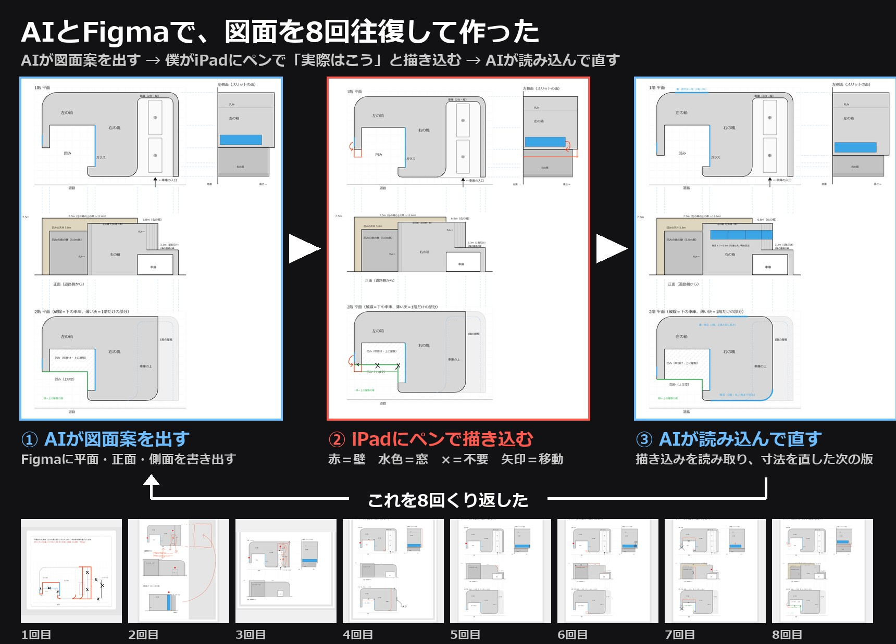
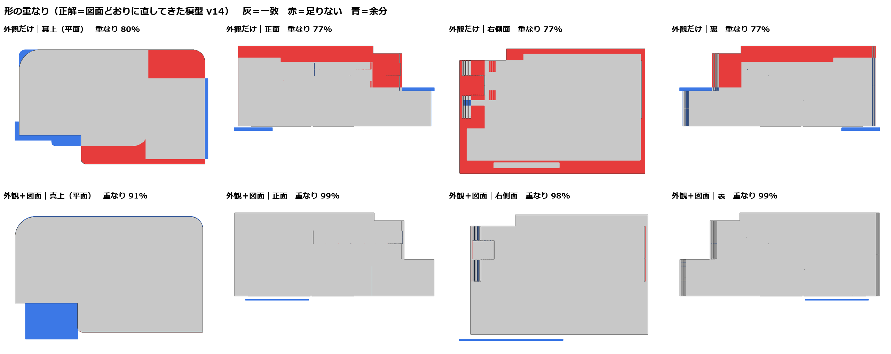
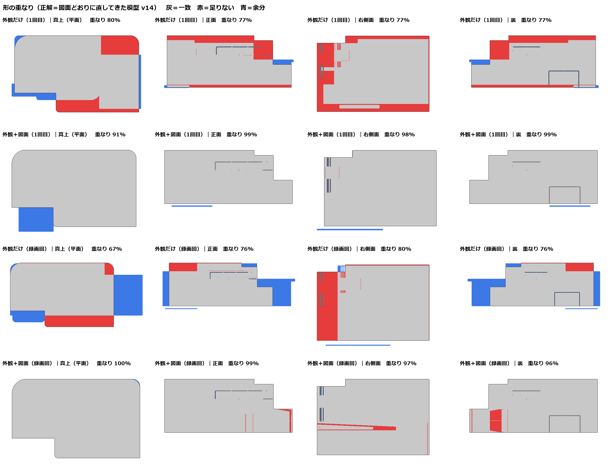

# 再現キット：外観だけ vs 外観＋図面で、AI に Rhino 模型を作らせる比較

この手順どおりにやれば、同じ比較ができるように全部入れています。

## 入っているもの
- `inputs/house_v6C.png`：外観（AI 画像、架空の家）
- `inputs/drawing_v14.png`：Figma で人と往復して整えた図面（1階平面・正面・左側面・2階平面、1マス＝1m）（公開版は図の題名から人名だけ外している。図の中身は B に渡したものと同じ）
  - 往復の過程（人の描き込み r1〜r9 と AI の書き出し v7〜v14）は Figma ボードで見られます（閲覧のみ）：https://www.figma.com/board/Fajd8nO7JFtNX5Ty2JOus4

  

- `prompts/A_image_only_prompt.md`・`prompts/B_image_plus_drawing_prompt.md`：AI に渡した指示（原文そのまま）
- `prompts/textures.md`：テクスチャのプロンプトと後処理
- `outputs/A/`・`outputs/B/`：AI が書いた模型スクリプト `model.py`、仮定した寸法 `params.json`、メモ `notes.md`
- `outputs/reference_v14.py`：正解の模型（図面どおり）
- `scripts/`：撮影・比較・シート作成（`run_compare.py`、`metrics.py`、`sheets.py`、`make_tex.py`）
- `tex/`：比較に使ったテクスチャ（色・法線・粗さ・AO）
- `results/`：比較画像と `metrics.json`

## 使ったもの
- AI：Claude Opus 5.5（Hermes Agent のサブエージェント。これまでの会話は渡していない）
- Rhino ＋ RhinoCommon（Python スクリプトとして実行）
- テクスチャ：ComfyUI（Comfy Cloud）Qwen-Image 2.1 t2i → seam → DeepBump → make_pbr
- 画像処理：Python 3 ＋ Pillow ＋ NumPy

## 手順
1. AI に `prompts/A_…md` の指示と外観画像だけを渡し、`model.py` を書かせる（Rhino は実行させない）。
2. 別の会話で、`prompts/B_…md` の指示と外観画像＋図面を渡し、同じように書かせる。
3. Rhino で `scripts/run_compare.py` を読み込み、`run(model.py のパス, 名前, ALIGN=True, ('concrete','black_mortar','rammed_earth'))` を実行。
   - 模型を作る → 地面と道路を共通のものに差し替え → 素材を共通で付ける → 同じカメラで撮る（外観と同じ角度・裏の左右・右前・斜め上、形の比較用に真上・正面・右側面・裏の平行投影）。
   - 原点は「建物の左端・一番前」に合わせる（画像だけでは原点が決まらないため）。
4. 正解（`outputs/reference_v14.py`）も ALIGN=False で同じく撮る。
5. `python metrics.py`：平行投影の影絵を重ね、±3m の範囲で一番重なる位置に平行移動してから、重なり率（IoU）・足りない割合・余分な割合を出す。
6. `python sheets.py`：比較画像を作る。

## 結果（2026-11-04、1回ずつ）
| 見る向き | A 外観だけ | B 外観＋図面 |
| --- | --- | --- |
| 真上 | 80% | 91% |
| 正面 | 77% | 99% |
| 右側面 | 77% | 99% |
| 裏 | 77% | 99% |

## 正直に書いておくこと
- A の `model.py` は、そのままだと壁が消えた（面の向きが内向き）。向きを直す 3 行だけ足して実行した（寸法は変えていない）。
- 正解も図面どおりの模型なので、図面を渡した B に有利な比べ方。
- 1 回ずつの試行。AI や回数を変えると結果はぶれる。
- 家は架空（AI 画像から作った）。

## 2回目（録画した回、2026-11-04）
同じ比較を、AI が Rhino に部分ごとに送って組み上げる形でもう一度やり、画面を録画した。
- 指示：`run2_recorded/prompts/A_prompt.md`・`B_prompt.md`（1回目と同じ文面に「Rhino で部分ごとに組む」を足しただけ。入力は `C:/rec/` に置いた）
- AI：Hermes Agent（Claude Opus 5.5）をターミナルで起動し、新しい会話で「C:\rec\A_prompt.md を読んで、その指示どおりに作業してください」とだけ入力
- 出力：`run2_recorded/outputs/A`・`B`、結果：`run2_recorded/results/`（`metrics_live.json`、`overlap_sheet_live.png`、`cmp_live.jpg`）

| 見る向き | A 外観だけ | B 外観＋図面 |
| --- | --- | --- |
| 真上 | 68% | 100% |
| 正面 | 76% | 99% |
| 右側面 | 80% | 97% |
| 裏 | 76% | 96% |

- A は大きさの仮定（絵を撮ったカメラの高さ）が1回目 2.1m・2回目 1.62m と変わり、形も毎回変わった。
- B は2回とも図面に書いてある所は正確。ずれたのは図面に無い所（右端の平屋のまわり、凹みの天井の素材）。

## 外壁のテクスチャ（外観に寄せたグレーの打放し）
- `tex/concrete_v6_src/`：ComfyUI の Qwen-Image 2.1（画像編集、入力＝外観画像）で作った素地 6 枚、プロンプト原文（`PROMPTS.md`）、組み立てスクリプト `make_concrete_v6.py`
- `uv run --with pillow --with numpy python make_concrete_v6.py` で 14.4m 角・4096px のシームレスなテクスチャ（basecolor / normal / roughness / AO / height）を作る。サイズが大きいので生成物はリポジトリに入れていない。

## パスについて
- スクリプト内の `C:/path/to/kit/` と、指示文の `<KIT>` は、このリポジトリを置いた場所に読み替えてください。
- 撮影は Rhino の Rendered 表示を `ViewCapture` で保存しています。Rhino の窓の大きさを変えると平行投影の縮尺が変わるので、全模型を同じ窓の状態で撮ってください。
