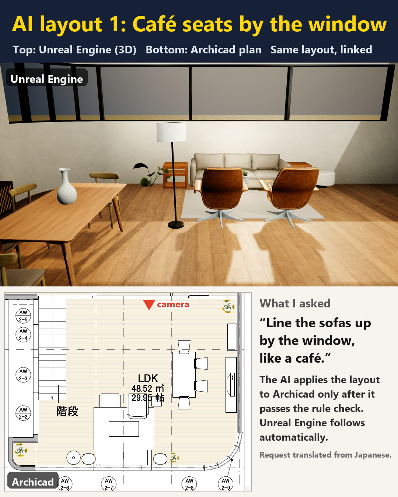
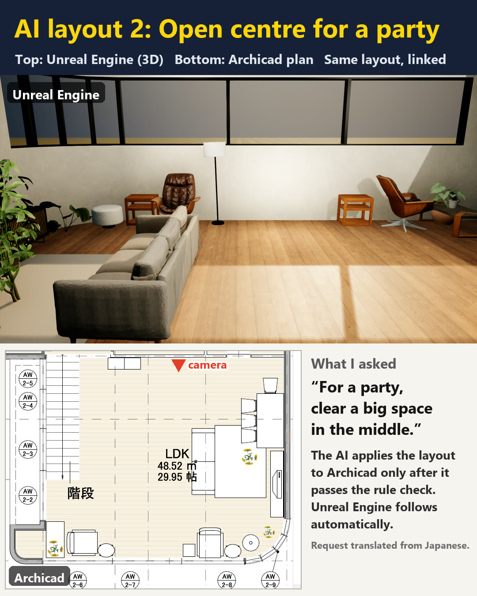
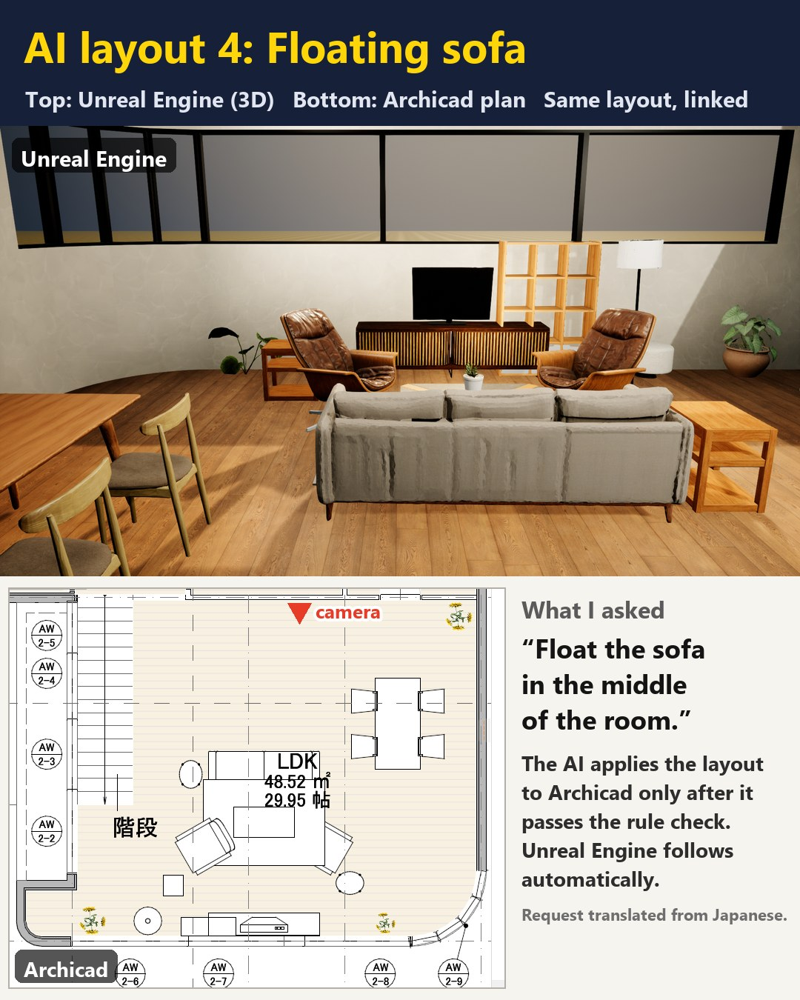
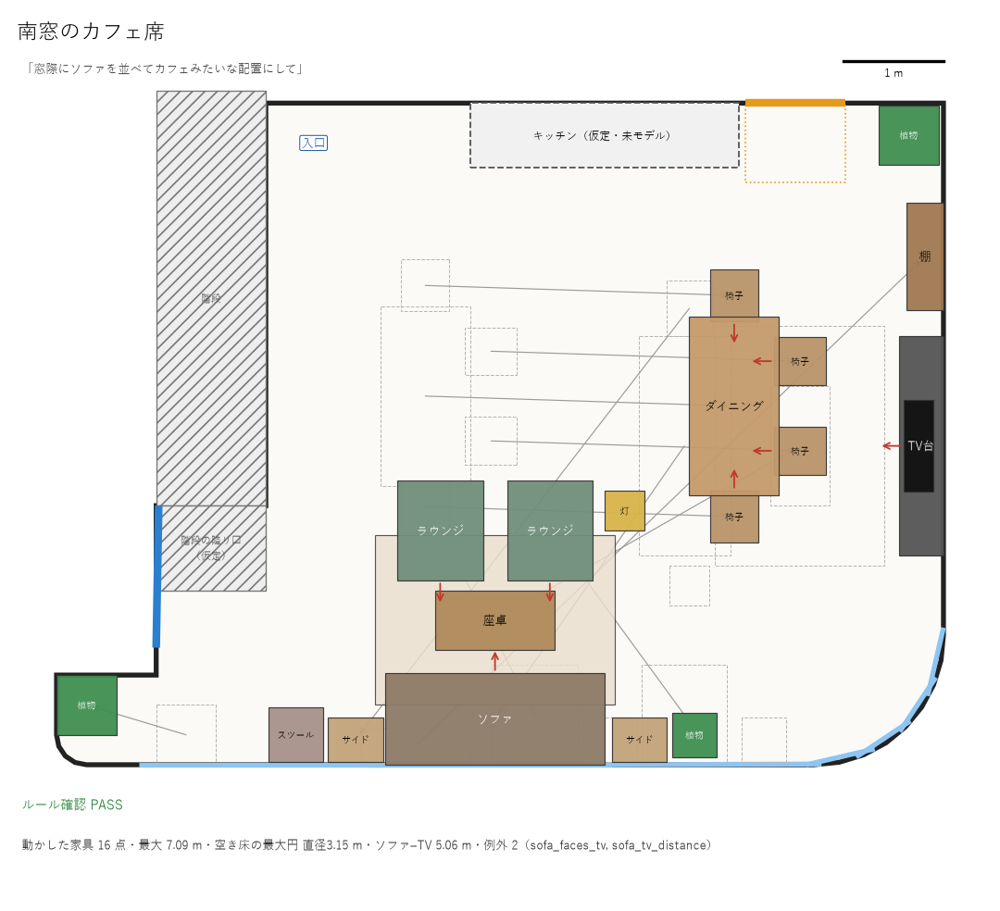
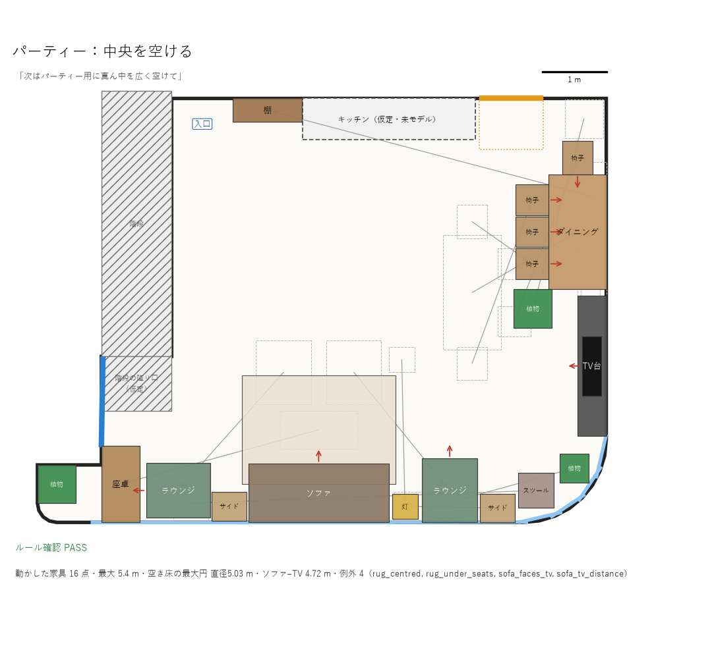
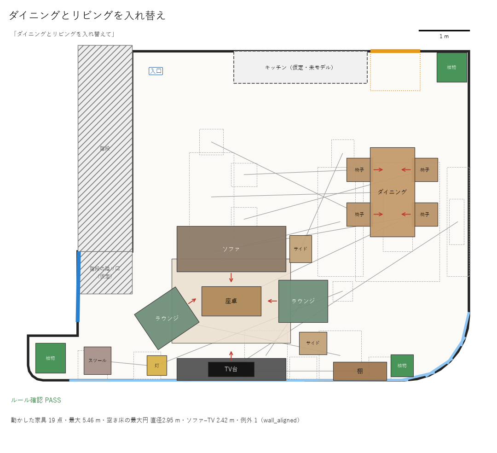
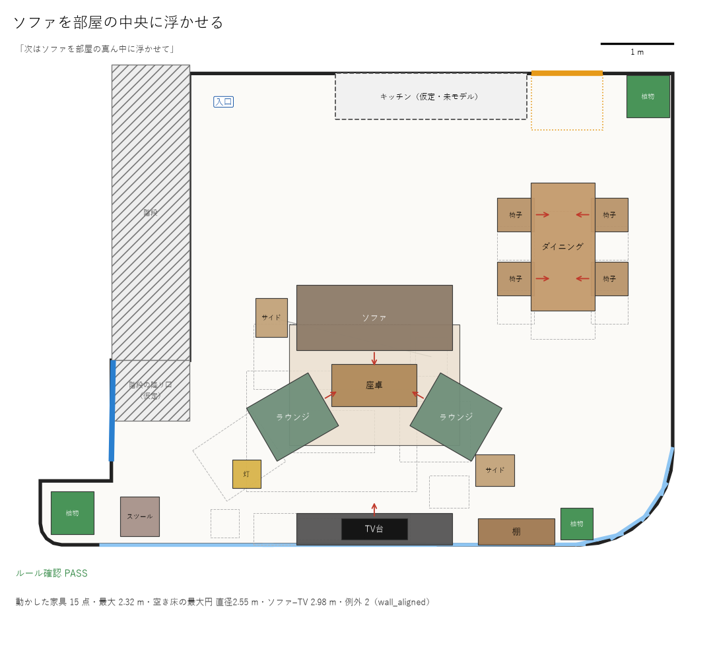
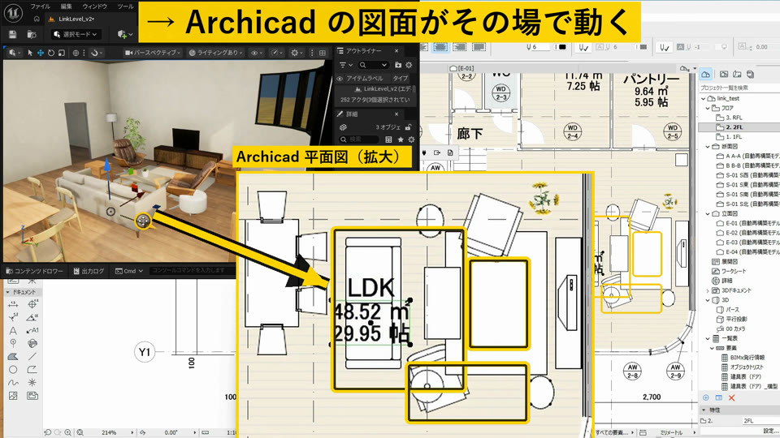
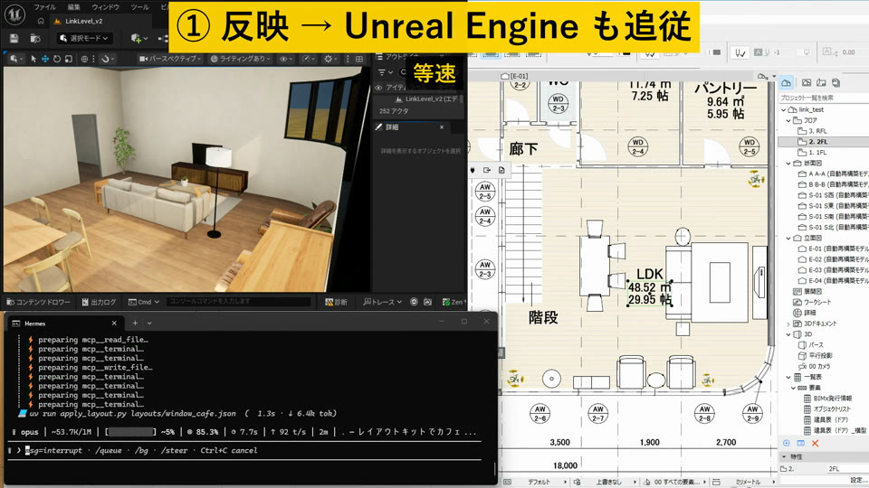
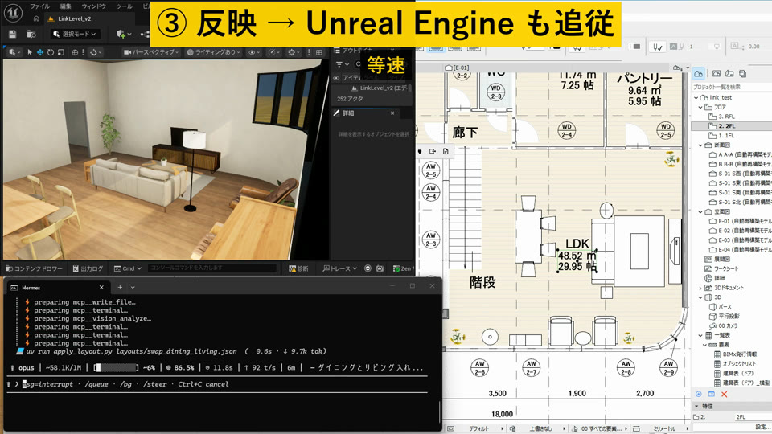

[🇯🇵 日本語](README.md) | 🇺🇸 English

# Ask the AI in one sentence, and the furniture layout changes in Archicad and Unreal Engine at the same time

Ask the AI "Line the sofas up by the window, like a café" and it **reads the room that is open in Archicad by itself, designs the furniture arrangement, checks it against rules (path widths and so on) and only then applies it to Archicad**.
If Unreal Engine is connected, the same furniture moves in the Unreal Engine 3D view on the spot. The other way round, move furniture in Unreal Engine and the Archicad floor plan follows.

No answers are prepared in advance. Every time, the AI designs from the current room (walls, windows, doors, stair, furniture).



**You do not need to write any code.** After a one-time setup, you just paste the "one line" from the table below into the AI.

## What it does (the four requests in the experiment)

| 2. For a party, clear a big space in the middle | 3. Float the sofa in the middle of the room |
| --- | --- |
|  |  |

Top views of the arrangements the AI designed (written by the AI and checked against the rules; labels in Japanese). Grey dotted outlines are the original positions.

| Café seats by the south window | Party: open centre |
| --- | --- |
|  |  |
| **Swap dining and living** | **Float the sofa in the middle** |
|  |  |

Frames from the recording (captions in Japanese).







## What you need

- **Archicad** + **Tapir**, the add-on that lets an AI drive Archicad
  - Draw the room as a Zone with a name (e.g. "LDK"), and place the furniture as Objects (library parts).
- **An AI**, one of these (both are paid plans):
  - a paid Claude plan + Claude Code (desktop app)
  - a paid ChatGPT plan + Codex (desktop app)
- **(For the 3D side) Unreal Engine 5** and the **Datasmith Exporter** for Archicad (a free add-on from Epic Games; Direct Link sends the Archicad model to Unreal Engine)
- **One-time setup (30–60 min)**: copy the "prompt for the AI" from the setup page below and paste it into the AI. It installs Tapir and connects the AI to Archicad.
  - Setup page: https://claude.ai/artifact/UwQrsxsWJztdwNVAd93t8T#en
  - Workshop slides (Japanese): https://docs.google.com/presentation/d/11fd7nvZPuE5BPmIBTQYlUanp_OZPNibPhbAnpD_UStg/edit?usp=sharing

## Getting started (once)

1. **Get this folder**: on this GitHub page, click the green "Code" button → "Download ZIP". Open the ZIP and put the "experiments" → "2026-11_unreal-archicad-link" folder somewhere easy to find. Below, its location is written `<KIT>` (e.g. `D:\layout_kit`).
2. **In the AI app, choose `<KIT>` as the working folder.**
3. With the Archicad project that contains the room open, paste this line into the AI. The AI adapts the room and furniture names (`config.json`) with you and checks the connection.
   ```
   Follow section "0" of AI_GUIDE.en.md in the layout kit at <KIT> and do the setup and connection check
   ```
4. **(For the 3D side) Unreal Engine setup**: follow [ue/README.en.md](ue/README.en.md) to import the Archicad house into Unreal Engine with Direct Link and start the follower script `ue_follow.py` (this is done by a person in the Unreal Engine editor).

## What to say to the AI (the same lines as in the recording)

These are the exact words given to the AI in the experiment (in Japanese; only the kit location is replaced by `<KIT>`). **The only difference is the AI you use** (the experiment used the Hermes Agent AI agent; you use Claude Code or Codex). The English below is a translation — you can write your request in English.

| # | Line to paste | What you see | Time (experiment) |
| --- | --- | --- | --- |
| 1 | New conversation: `<KIT> のレイアウトキットの AI_GUIDE.md に従って、窓際にソファを並べてカフェみたいな配置にして` ("Following AI_GUIDE.md in the layout kit at `<KIT>`, line the sofas up by the window, like a café") | The AI reads the room, writes the arrangement and checks it (passed on the 3rd check in the experiment). Once it passes, the Archicad plan and the Unreal Engine furniture move together (16 pieces) | Request → applied: about 1 min 44 s |
| 2 | Same conversation: `次はパーティー用に真ん中を広く空けて` ("Next, for a party, clear a big space in the middle") | In the experiment one rule was still failing after 3 fixes, so the AI asked "May I fix it, check once more and then apply?". Answering `はい、直して確認してから反映して` ("Yes, fix it, check and then apply") applied it (17 pieces; largest open-floor circle 3.15 m → 5.03 m) | To the question: about 2 min 31 s; answer → applied: about 9 s |
| 3 | New conversation: `<KIT> のレイアウトキットの AI_GUIDE.md に従って、ダイニングとリビングを入れ替えて。チェックが PASS したら確認せずにそのまま反映して` ("Following AI_GUIDE.md in the layout kit at `<KIT>`, swap the dining and living areas. If the check passes, apply it without asking") | Once the check passes, it is applied without asking (19 pieces) | Request → applied: about 2 min 58 s |
| 4 | Same conversation: `次はソファを部屋の真ん中に浮かせて` ("Next, float the sofa in the middle of the room") | In the experiment the AI asked: "The guide says stop after 3 tries. If I may fix it once more and apply when it passes, say 'continue'". Answering `続けて` ("continue") applied it (15 pieces) | To the question: about 1 min 45 s; answer → applied: about 13 s |

- Replace the request itself (the café part) with whatever you want. For example: "Make a reading corner by the window; we don't need the TV", "Dinner for six guests — make the dining table the centre of the room".
- The AI only applies arrangements that pass the rules. If a request conflicts with the rules, it tells you what clashes.
- Before every apply, the previous furniture positions are saved automatically. To go back, ask "Undo the last apply" (this wording was not used in the experiment; AI_GUIDE explains how to undo).

## What the person does

- Keep the Archicad project with the room open (the AI only reads the room; it does not build walls or rooms).
- For the 3D side, open Unreal Engine and keep `ue_follow.py` running ([ue/README.en.md](ue/README.en.md)).
- Answer when the AI asks (the "yes" / "continue" in 2 and 4).
- Look at the result in Archicad and Unreal Engine, and if you don't like it, ask for a change with the next line.
- Save (the AI does not save).

## Using it in your own office

- **Room and furniture names**: `config.json` holds the room's zone name and the mapping from library-part names to furniture kinds (sofa, dining chair, TV …). Ask the AI to adapt it to your model with the line in "Getting started" step 3.
- **Layout rules**: path widths (main path 0.8 m, to furniture 0.6 m), sofa–TV distance (2.0–3.6 m), no TV in front of a window, room to pull out dining chairs (0.6 m), etc. The full list is the "Rules" table in [AI_GUIDE.en.md](AI_GUIDE.en.md). They are general interior rules of thumb; to use your office's standards, ask the AI, e.g. "make the main path 0.9 m wide".

## Honest notes

- **Tested**: the four lines above were entered on 17 November 2026 into new conversations of the Hermes Agent AI agent (AI: Claude Opus 5.5), and recorded. The arrangements and check results the AI wrote are in the `recorded` folder as they were (in the recording the AI writes to `layouts`; for publication they were moved to `recorded` so they cannot be reused as answers).
- **Fresh Claude Code run (November 17, 2026)**: in a freshly cloned copy of this folder, a Claude Code session with no prior conversation (command-line `claude -p`, model Claude Opus 5.5) was given the setup line from "Getting started" step 3 and then row ① of the table, word for word. Setup line: it read AI_GUIDE, connected through Tapir and listed the room (20 pieces, none of unknown type) in 41 s, without changing `config.json`. Row ①: following AI_GUIDE it read the room, wrote a layout, passed the rule check on the 2nd try and applied 17 pieces to Archicad (about 1 min 40 s from request to apply). The undo line it reported was then used to restore the layout, and all furniture positions were confirmed back within 0 mm. It did not get stuck anywhere.
- **Not tested yet**: a full run with Codex, a run in the desktop apps, rows ②–④, and "Getting started" step 3 on a model other than the experiment's (fitting `config.json`). The run above used the same fictional house as the experiment (`config.json` as shipped). Please tell us where you get stuck.
- **The Unreal Engine follower (`ue/ue_follow.py`)** was tested on its own in Unreal Engine on 17 November 2026: move in Archicad → Unreal Engine follows in about 0.6 s; drag for 2.5 s in Unreal Engine → the Archicad plan moves during the drag; applying a kit layout (17 pieces) and undoing it → every piece followed with 0 cm position difference. However, while the four requests were being recorded, an earlier development version of the follower script (same job) was running.
- The opening scene "move with the mouse in Unreal Engine" comes from a different recording than the four requests. The videos fast-forward while the AI is thinking and cut the waiting time until a person answered the AI's question. The times in the table are the real times measured from the recordings.
- The rules only check numbers on the plan. They do not look at TV reflections, glare, or the look and feel of the furniture. The front of each piece is assumed to be the library part's local +y side (`front_axis` in `config.json`).
- The furniture look in Unreal Engine comes from separate 3D furniture attached with `ue/ue_attach.py` (those 3D models, the Unreal Engine project and the Archicad file are not in this folder).
- The `examples` folder is a development test record of the same four requests (the AI role was played by the AI agent used for development).
- The house is fictional. AI answers differ every time, so the same request will not give the same arrangement.
- Used: AI — Claude Opus 5.5 (run from the Hermes Agent AI agent); software — Archicad with Tapir, Unreal Engine with Datasmith Direct Link. 17 November 2026.

## For advanced users and AIs

- [AI_GUIDE.en.md](AI_GUIDE.en.md): the procedure for AIs (setup, reading the room, layout format, rule list, applying, undo)
- [ue/README.en.md](ue/README.en.md): Unreal Engine setup and the follower (`ue_follow.py`), attaching furniture meshes, swapping materials, pitfalls
- Contents: `read_room.py` (read the room), `check_layout.py` (check against the rules), `apply_layout.py` (apply to Archicad), `tapir.py` (talks to Archicad), `config.json` (room and furniture settings), `room.json` (the room as read in the experiment), `ue/` (Unreal Engine side), `recorded/` (arrangements the AI wrote in the experiment), `examples/` (development tests), `layouts/` (where the AI writes new arrangements)
- Updates: X [@supertask_jp](https://x.com/supertask_jp) (Japanese); article (note: coming soon)
