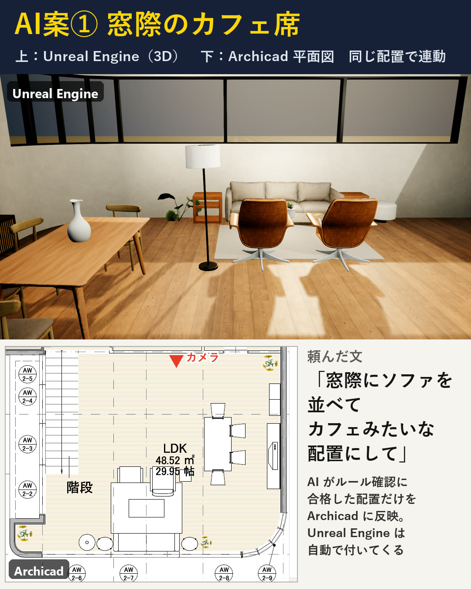
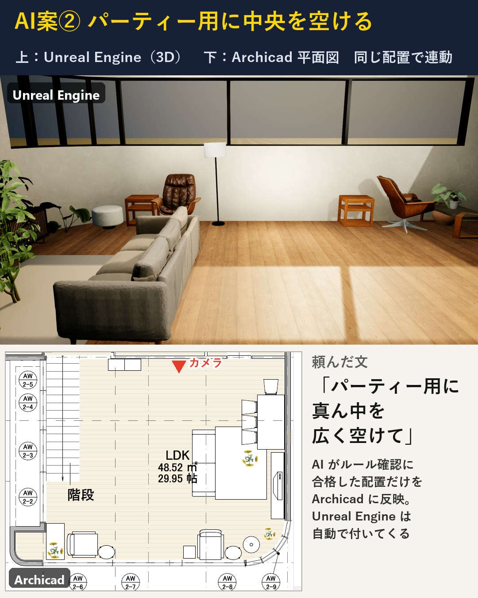
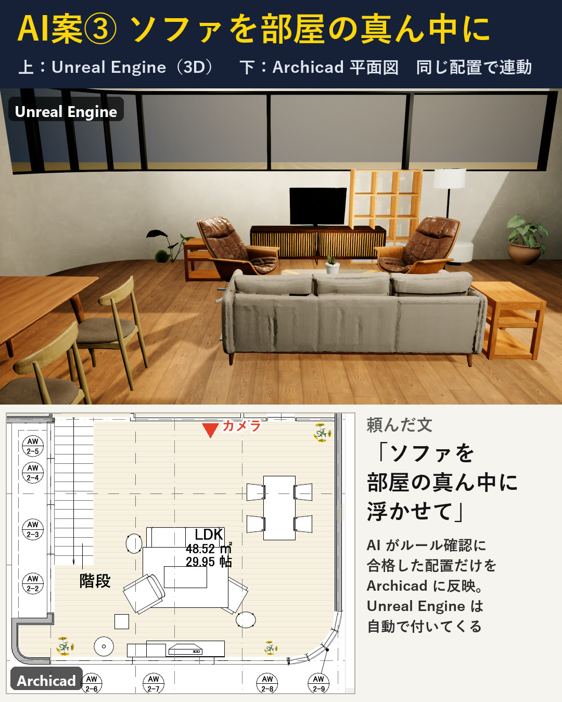
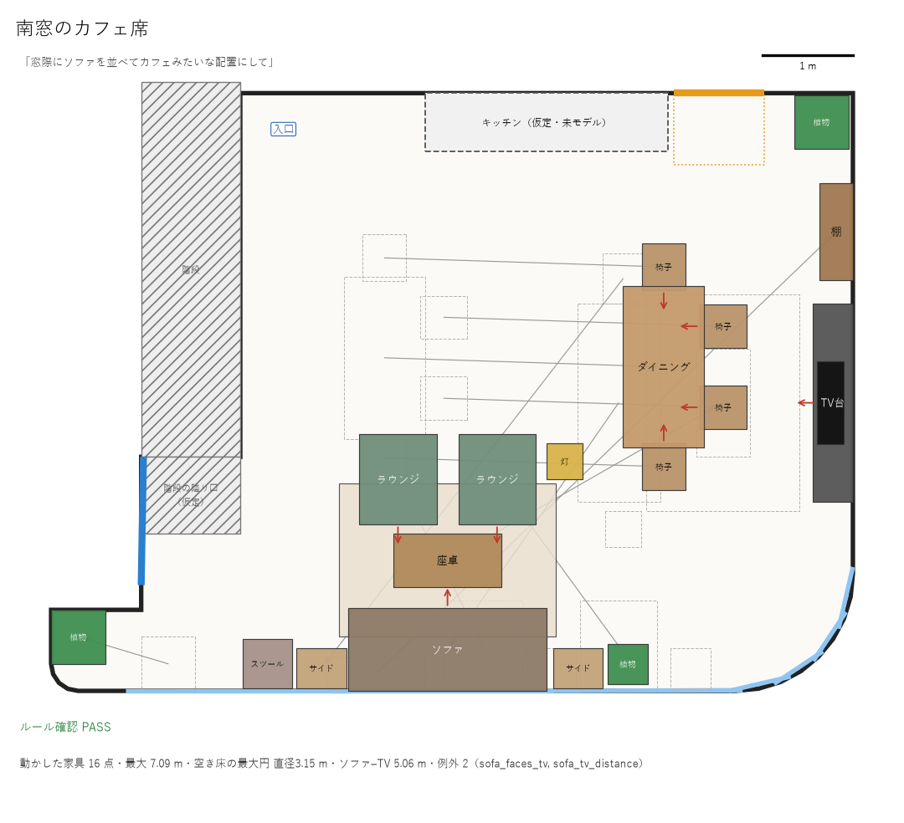
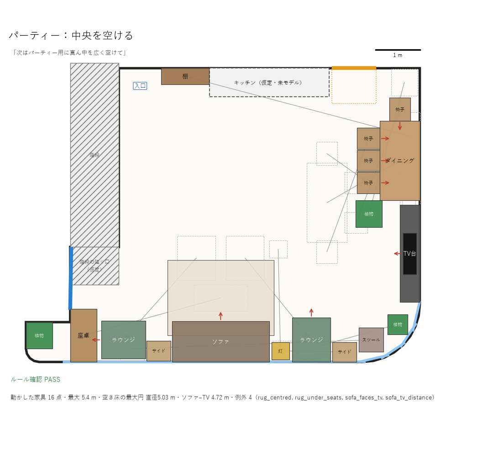
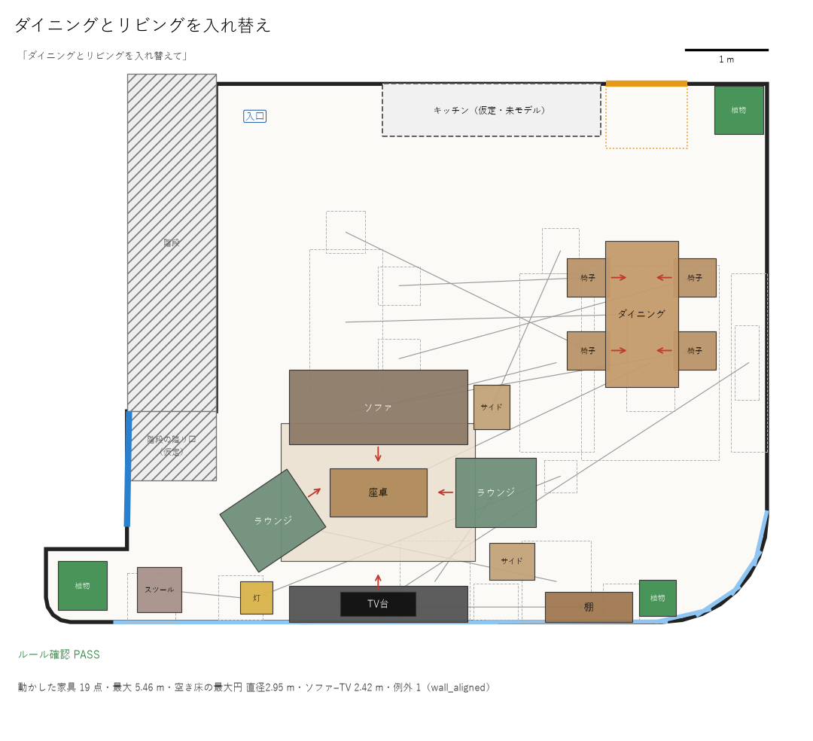
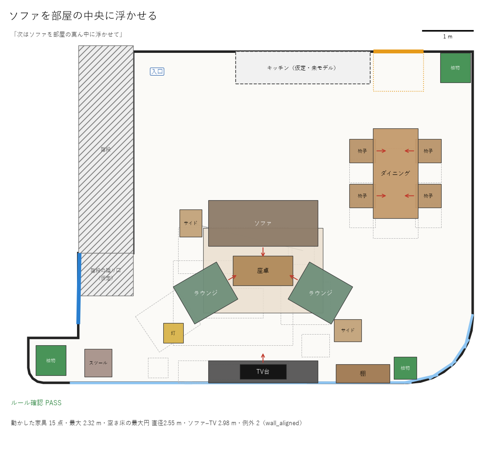
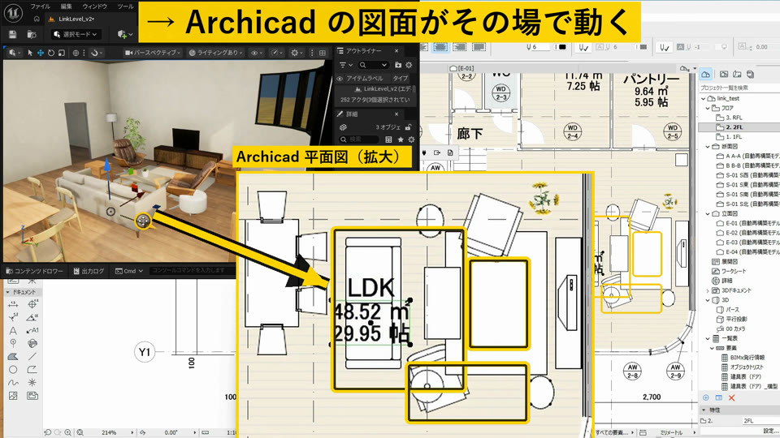
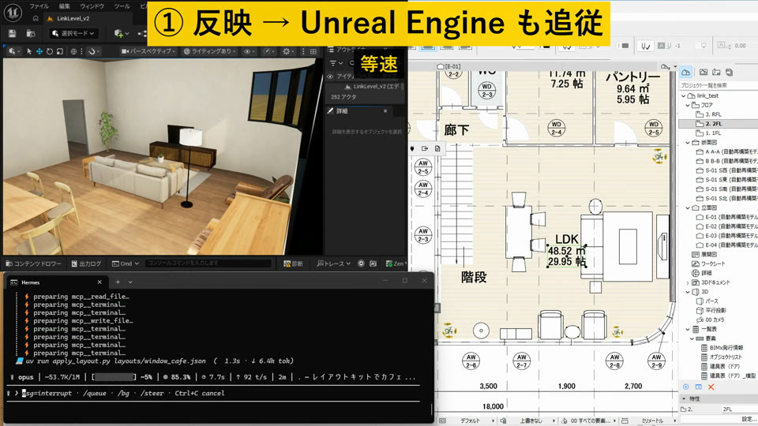
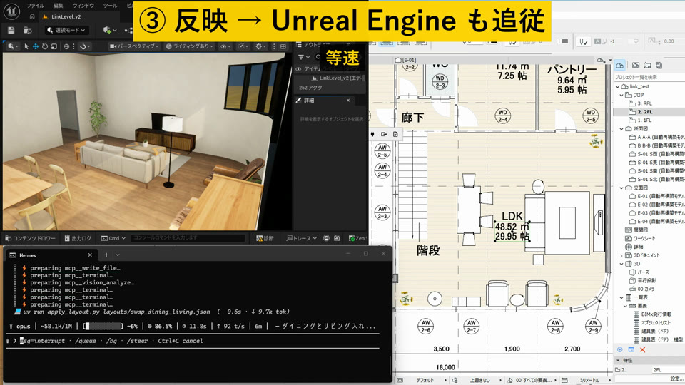

🇯🇵 日本語 | [🇺🇸 English](README.en.md)

# AI にひとこと頼むと、家具の配置が Archicad と Unreal Engine に同時に反映される

「窓際にソファを並べてカフェみたいな配置にして」と AI に頼むと、AI が **Archicad で開いている部屋を自分で読み、家具の配置を考え、決まり（通路の幅など）で確かめてから Archicad に反映** します。
Unreal Engine をつないでおけば、同じ家具が Unreal Engine の 3D でもその場で動きます。逆に Unreal Engine で家具を動かすと、Archicad の平面図が付いてきます。

配置の答えは用意していません。毎回、その時の部屋（壁・窓・ドア・階段・家具）から AI が考えます。



**プログラムを書く必要はありません。** 最初の準備さえ済めば、あとは下の表の「1行」を AI に貼るだけです。

## できること（実験で頼んだ4つ）

| ② パーティー用に真ん中を広く空けて | ③ ソファを部屋の真ん中に浮かせて |
| --- | --- |
|  |  |

AI が考えた配置の上面図（AI が自分で書いて、決まりで確かめたもの）。灰色の点線が元の位置です。

| 窓際のカフェ席 | パーティー：中央を空ける |
| --- | --- |
|  |  |
| **ダイニングとリビングを入れ替え** | **ソファを部屋の中央に浮かせる** |
|  |  |

録画の一場面です。







## 用意するもの

- **Archicad** ＋ AI から Archicad を動かすための追加機能 **Tapir**
  - 部屋は「ゾーン」で描いて名前（例「LDK」）を付け、家具は「オブジェクト」（ライブラリ部品）で置いておきます。
- **AI**：次のどちらか（どちらも有料プラン）
  - Claude の有料プラン ＋ Claude Code（デスクトップ版のアプリ）
  - ChatGPT の有料プラン ＋ Codex（デスクトップ版のアプリ）
- **（3D も動かすなら）Unreal Engine 5** と、Archicad 用の **Datasmith Exporter**（Epic Games の無料の追加機能。Direct Link で Archicad の形を Unreal Engine に送ります）
- **最初の1回だけの準備（30〜60分）**：下の資料にある「AI への頼み文（プロンプト）」をコピーして AI に貼ると、AI が Tapir などを入れて、Archicad とつないでくれます。
  - セットアップ資料：https://claude.ai/artifact/UwQrsxsWJztdwNVAd93t8T#ja
  - 講座のスライド：https://docs.google.com/presentation/d/11fd7nvZPuE5BPmIBTQYlUanp_OZPNibPhbAnpD_UStg/edit?usp=sharing

## はじめに（1回だけ）

1. **このフォルダを手元に置く**：このページ（GitHub）の上の方の緑色の「Code」ボタン →「Download ZIP」。ZIP を開き、中の「experiments」→「2026-11_unreal-archicad-link」フォルダを、わかりやすい場所に置きます。以下、このフォルダの場所を `<KIT>` と書きます（例：`D:\layout_kit`）。
2. **AI のアプリで、作業するフォルダとして `<KIT>` を選ぶ**。
3. Archicad で部屋のあるプロジェクトを開いたまま、AI に次の1行を貼ります。AI が、部屋の名前や家具の名前の設定（`config.json`）を一緒に合わせ、つながっているかを確かめます。
   ```
   <KIT> のレイアウトキットの AI_GUIDE.md の「0」に従って、準備と接続確認をして
   ```
4. **（3D も動かすなら）Unreal Engine の準備**：[ue/README.md](ue/README.md) の手順で、Unreal Engine の画面から Direct Link で Archicad の家を取り込み、見張り役のスクリプト `ue_follow.py` を動かします（人が画面で行う作業です）。

## AI に話しかける言葉（録画と同じ1行）

実験で AI に入れた言葉そのままです（キットの場所だけ `<KIT>` に置き換えています）。**違うのは使う AI だけ**です（実験は AI エージェント Hermes Agent、皆さんは Claude Code か Codex）。

| 順 | AI に貼る1行 | 画面で見えること | 時間（実験） |
| --- | --- | --- | --- |
| ① | 新しい会話で：`<KIT> のレイアウトキットの AI_GUIDE.md に従って、窓際にソファを並べてカフェみたいな配置にして` | AI が部屋を読み、配置を書き、決まりで確かめる（実験では3回目で合格）。合格すると、Archicad の平面図と Unreal Engine の家具が一度に動く（16点） | 頼んでから反映まで 約1分44秒 |
| ② | 同じ会話で続けて：`次はパーティー用に真ん中を広く空けて` | 実験では、3回直しても決まりが1つ残り、AI が「直して、もう1回確かめてから反映してよいですか」と聞いてきた。`はい、直して確認してから反映して` と答えると反映（17点。空いた床の円が直径 3.15 m → 5.03 m） | 質問まで 約2分31秒、返事から反映まで 約9秒 |
| ③ | 新しい会話で：`<KIT> のレイアウトキットの AI_GUIDE.md に従って、ダイニングとリビングを入れ替えて。チェックが PASS したら確認せずにそのまま反映して` | 確かめに合格したら、聞かずにそのまま反映（19点） | 頼んでから反映まで 約2分58秒 |
| ④ | 同じ会話で続けて：`次はソファを部屋の真ん中に浮かせて` | 実験では、AI が「決まりでは3回で止める。もう1回直して合格したら反映してよければ『続けて』」と聞いてきた。`続けて` と答えると反映（15点） | 質問まで 約1分45秒、返事から反映まで 約13秒 |

- 「」の中身（窓際に…）を、自分の頼みたいことに替えて使えます。例：「窓辺に本を読むコーナーを作って、テレビは見なくていい」「来客6人で食事できるように、ダイニングを主役に」。
- AI は、決まりに合格した配置しか Archicad に反映しません。決まりと両立しない頼みには、何がぶつかっているかを返してきます。
- 反映のたびに、直前の家具の位置が自動で保存されます。元に戻したい時は「さっきの反映を元に戻して」と頼みます（この言い方は実験では使っていません。AI_GUIDE に戻し方が書いてあります）。

## 人がやること

- Archicad で部屋のあるプロジェクトを開いておく（AI は部屋を読むだけで、壁や部屋は作りません）。
- 3D も動かすなら、Unreal Engine を開き、`ue_follow.py` を動かしておく（[ue/README.md](ue/README.md)）。
- AI に聞かれたら答える（②④の「はい」「続けて」）。
- できた配置を Archicad と Unreal Engine で見て、気に入らなければ次の1行で直してもらう。
- 保存は人が行う（AI は保存しません）。

## 自分の事務所で使うには

- **部屋と家具の名前**：`config.json` に、部屋のゾーン名と、家具の部品名→種類（ソファ・ダイニングチェア・テレビ…）が書いてあります。自分のモデルに合わせる作業は、上の「はじめに」3 の1行で AI に頼めます。
- **配置の決まり**：通路の幅（主な通路 0.8 m・家具へ 0.6 m）、ソファとテレビの距離（2.0〜3.6 m）、窓の前にテレビを置かない、ダイニングの椅子の引きしろ（0.6 m）、などです。一覧は [AI_GUIDE.md](AI_GUIDE.md) の「ルール」の表にあります。インテリアの一般的な目安から作ったもので、自分の事務所の基準に変えたい時は「通路の幅を 0.9 m にして」のように AI に頼めます。

## 正直に書いておくこと

- **試したこと**：上の4つの1行は、2026年11月17日に、AI エージェント Hermes Agent（AI は Claude Opus 5.5）の新しい会話に入れて実行し、録画したものです。AI が書いた配置と確かめの結果は `recorded` フォルダにそのまま入れています（録画の画面では `layouts` フォルダに書いていますが、公開では答えを流用されないよう `recorded` に移しました）。
- **まだ試していないこと**：**Claude Code・Codex のアプリで、このキットだけを使って最初から通した試しは、まだありません。**「はじめに」3 の準備と接続確認の1行は公開用に足したもので、実験では使っていません（実験では、`config.json` の値と部屋のゾーン、Unreal Engine の Direct Link は先に用意してありました）。つまずいた所があれば教えてください。
- **Unreal Engine の見張り（`ue/ue_follow.py`）**：2026年11月17日に Unreal Engine で単独で試しました。Archicad で動かす → Unreal Engine が約0.6秒で付いてくる。Unreal Engine で 2.5 秒ドラッグ → ドラッグ中から Archicad の平面図が動く。キットの配置の反映（17点）と元に戻す操作 → 全点が付いてきて位置の差 0 cm。ただし、上の4つを録画した時に動いていたのは、同じ働きをする開発中の前の版の見張りスクリプトです。
- 冒頭の「Unreal Engine でマウスで動かす」場面は、4つの依頼とは別の回の録画です。動画は AI が考えている間を早送りし、AI の質問に人が答えるまでの待ち時間を切っています。表の時間は録画から測った実際の時間です。
- 決まりは平面の数値の確かめだけです。テレビの映り込みや逆光、家具の質感や雰囲気までは見ていません。家具の正面は「ライブラリ部品のローカル +y 側」と仮定しています（`config.json` の `front_axis`）。
- Unreal Engine 側の家具の見た目は、`ue/ue_attach.py` で別に付けた 3D の家具です（その 3D の家具、Unreal Engine のプロジェクト、Archicad のファイルはこのフォルダに入れていません）。
- `examples` フォルダは、開発中に同じ4つの頼みを試した動作確認の記録です（AI の役は開発に使った AI エージェント自身）。
- 家は架空です。AI の答えは毎回変わるので、同じ頼みでも同じ配置にはなりません。
- 使ったもの：AI は Claude Opus 5.5（Claude Code の契約で、AI エージェント Hermes Agent から利用）、ソフトは Archicad と Tapir、Unreal Engine と Datasmith Direct Link。2026年11月17日。

## 詳しい人・AI 向け

- [AI_GUIDE.md](AI_GUIDE.md)：AI 向けの手順（準備・部屋の読み取り・配置の書き方・決まりの一覧・反映・元に戻し方）
- [ue/README.md](ue/README.md)：Unreal Engine 側の準備と見張り（`ue_follow.py`）、家具の付け替え、素材の差し替え、落とし穴
- 入っているもの：`read_room.py`（部屋を読む）、`check_layout.py`（決まりで確かめる）、`apply_layout.py`（Archicad に反映）、`tapir.py`（Archicad との通信）、`config.json`（部屋と家具の設定）、`room.json`（実験の部屋の読み取り結果）、`ue/`（Unreal Engine 側）、`recorded/`（実験で AI が書いた配置）、`examples/`（開発中の動作確認）、`layouts/`（AI が新しい配置を書く場所）
- 発信：X [@supertask_jp](https://x.com/supertask_jp)、解説記事（note: coming soon）
